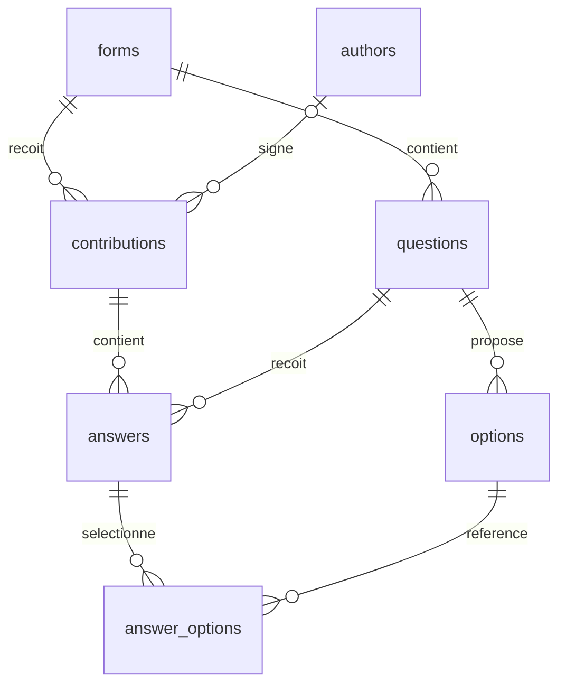
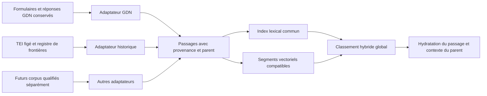

# Audit exploratoire — cahiers de 1789 et recherche multicorpus

Audit du 25 octobre 2026. **Décision proposée : poursuivre avec un pilote documentaire contrôlé, sans importer directement les volumes Stanford dans le moteur public.** Une évolution additive est possible ; transformer les cahiers en formulaires serait une mauvaise adaptation.

Les résultats de cette mission sont uniquement des fichiers d’étude. Aucun accès à une base, aucune migration, aucun embedding, aucune modification applicative ou configuration de production n’a été effectué.

## 1. Résultats décisifs et niveau de preuve

- **Vérifié sur l’ensemble du dépôt :** 83 fichiers XML, correspondant aux volumes 1 à 82, le volume 71 étant réparti en 71A et 71B. Le README Stanford annonce 82 volumes : ce nombre désigne la tomaison, pas le nombre de fichiers. Les 83 XML sont bien formés avec le parseur employé, sans récupération d’erreurs ; ce n’est pas une validation de conformité à la DTD.
- **Vérifié par comptage reproductible :** dans les volumes 1–6, 1 722 divisions `body//div3`, dont 1 214 contiennent « cahier » ou « doléance » dans leurs titres et 1 140 commencent par le mot singulier « CAHIER ». **Aucun de ces nombres n’est un décompte certifié de cahiers distincts exploitables.**
- **Vérifié par lecture ciblée :** certains cahiers sont répartis entre plusieurs divisions de même niveau ; d’autres divisions ne contiennent qu’une notice de cahier absent ; certaines regroupent cahier, supplément, certification et signatures. Un cahier annoté se trouve aussi au volume 32.
- **Vérifié sur l’échantillon :** 28 passages extraits de sept cahiers, répartis dans les six premiers volumes, sans correction du texte TEI. Sept transcriptions intégrales des divisions retenues, six fragments problématiques et des références aux scans sont livrés. Quatre pages ont été comparées aux transcriptions, puis une cinquième pour le cas de Cambrai.
- **Vérifié dans le code :** le moteur possède déjà une séparation unité documentaire / représentation vectorielle, des empreintes, des offsets, des index PostgreSQL et une fusion RRF. En revanche, les contrats, contraintes SQL, lecteurs, regroupements et réponses publiques sont spécialisés GDN. L’ajout d’un `corpus_id` ne suffit pas.
- **Proposition :** ajouter progressivement corpus, documents et passages, conserver les tables de formulaires, puis adapter le contrat de recherche dans une génération séparée. Les algorithmes et l’infrastructure peuvent rester largement les mêmes.
- **Non établi :** nombre exact de cahiers uniques, taux global d’extractibilité, taux d’erreur OCR, qualité sémantique transhistorique, état réel des schémas/index en production. Ces points ne sont pas remplacés par des estimations non fondées.

## 2. Sources, périmètre et reproductibilité

### Snapshot Stanford

Source : [StanfordUniversityLibraries/ap_tei](https://github.com/StanfordUniversityLibraries/ap_tei), révision immuable [`926fd3cd986a3c3d411e93d1845fff6475cb2602`](https://github.com/StanfordUniversityLibraries/ap_tei/tree/926fd3cd986a3c3d411e93d1845fff6475cb2602). Téléchargement dans `/tmp/cahier-audit-1789/ap_tei-master`, séparé de l’application. Les SHA Git des **88 fichiers** de l’archive ont été comparés à l’arbre GitHub de cette révision : aucune différence. Les XML totalisent 513 226 252 octets. Le téléchargement initial de `master` a ainsi été rattaché et vérifié contre une révision précise.

Code applicatif lu à la révision `818b5464f24cac4d8537793c15c8e2c580505f88`. L’état Git était propre avant l’audit. Les observations de schéma viennent des modèles, migrations et SQL du dépôt, **pas d’une introspection d’une base vivante**. Les chaînes de connexion et fichiers d’environnement privés n’ont pas été ouverts pour cette mission.

Le protocole, les données calculées et les limites se trouvent dans :

| Fichier | Rôle |
|---|---|
| [extract.py](extract.py) | Inventaire et extraction locale déterministe ; aucun accès réseau ou base |
| [selection.json](selection.json) | Sélection relue, limites des articles et provenance des métadonnées |
| [data/inventory.json](data/inventory.json) | 83 volumes : mapping, empreintes, tailles, dates éditoriales, nombres de balises |
| [data/divisions.json](data/divisions.json) | Titres, débuts et positions de toutes les divisions `body//div3`, y compris hors 1789 |
| [data/screening.json](data/screening.json) | Repérage prudent des notices d’absence, marqueurs d’articles et doublons exacts |
| [data/passages.json](data/passages.json) | 28 passages et leurs plages sources |
| [data/documents.json](data/documents.json) | Sept transcriptions intégrales, blocs et métadonnées sourcées |
| [data/documents/](data/documents/) | Fragments XML et textes complets des sept divisions |
| [data/problematic/](data/problematic/) | Cas exclus ou nécessitant une reconstruction documentaire |
| [data/source-pages.json](data/source-pages.json) | Pages TEI, canvases IIIF, services images, attribution et empreintes de manifestes |
| [quality-review.json](quality-review.json) | Comparaisons visuelles ponctuelles, sans taux d’erreur extrapolé |
| [provenance.json](provenance.json) | Versions et sources consultées |
| [verify.py](verify.py) | Contrôle des extractions, des empreintes, des positions et des références |

Reproduction, dans un environnement d’audit disposant de Python et `lxml` :

```bash
python 1789/archives/1789-multicorpus/extract.py \
  /tmp/cahier-audit-1789/ap_tei-master \
  --output /tmp/ap-audit-reproduit \
  --evidence /tmp/cahier-audit-1789/evidence

python 1789/archives/1789-multicorpus/verify.py \
  --source /tmp/cahier-audit-1789/ap_tei-master
```

Pour récupérer à nouveau le snapshot, utiliser l’archive de la révision figée, puis fournir son dossier extrait comme `source` : [archive GitHub de la révision](https://codeload.github.com/StanfordUniversityLibraries/ap_tei/tar.gz/926fd3cd986a3c3d411e93d1845fff6475cb2602). Les empreintes de fichiers dans `source-tree.json` permettent de contrôler le contenu indépendamment du nom du dossier extrait. Les manifestes sont disponibles à `https://purl.stanford.edu/{druid}/iiif/manifest` et doivent être enregistrés sous `{druid}.manifest.json` dans le dossier d’évidence ; le JSON livré référence les six volumes utilisés. Leur enrichissement dépend d’une réponse externe susceptible d’évoluer.

`--evidence` est facultatif : il lit les manifestes IIIF préalablement téléchargés ; sans eux, les textes et identifiants sont les mêmes, les liens précis aux canvases ne sont pas enrichis. Les images consultées restent dans l’espace temporaire, sans être redistribuées dans le dépôt. Les résultats d’inventaire parcourent tout le corpus Stanford ; la lecture documentaire approfondie reste un échantillonnage raisonné.

### Vérifications effectuées

- Contrôle des 88 empreintes Git du snapshot et des 83 SHA-256 XML.
- Contrôle des 28 passages : unicité, texte, plages Unicode exactes, ordre, rattachement aux sept parents, libellés et liens IIIF.
- Comparaison des textes complets exportés avec les divisions des fichiers source ; contrôle des six fragments problématiques.
- Deux extractions indépendantes : les six sorties JSON calculées sont identiques octet pour octet.
- `ruff check` et `ruff format --check` réussis sur les deux scripts ; liens locaux du rapport vérifiés.
- État Git : uniquement des ajouts dans ce dossier d’audit. Les suites applicatives, frontend et base n’ont pas été lancées : aucun code applicatif n’a changé et aucune base n’a été sollicitée.

## 3. Inventaire historique : des volumes ne sont pas des cahiers

Les [tables de correspondance du dépôt](https://github.com/StanfordUniversityLibraries/ap_tei/blob/926fd3cd986a3c3d411e93d1845fff6475cb2602/vol-to-druid.csv) donnent les fichiers suivants :

| Volume | Druid / fichier XML dans son dossier | `body//div3` | Titre contenant cahier/doléance | Début de titre CAHIER singulier |
|---|---|---:|---:|---:|
| 1 | jt959wc5586.xml | 139 | 20 | 18 |
| 2 | fz023dp4399.xml | 207 | 182 | 168 |
| 3 | mc666yy3026.xml | 319 | 196 | 161 |
| 4 | xg914wh0253.xml | 373 | 335 | 333 |
| 5 | xx284sn7328.xml | 339 | 288 | 282 |
| 6 | wg983ft3682.xml | 345 | 193 | 178 |
| **1–6** | | **1 722** | **1 214** | **1 140** |
| 7 | jr712gv3760.xml | 31 | 0 | 0 |
| 32 | yk966sx2246.xml | 135 | 1 | 1 |

Le volume 7 contient les tables des cahiers ; il ne faut pas indexer ses entrées comme des revendications. Les autres fichiers n’ont pas de `div3` dont le titre corresponde au repérage cahier/doléance, à l’exception du volume 32. **Ce test ne prouve pas l’absence de cahiers ou de citations de cahiers ailleurs** : un titre différent ou un document enfoui dans des paragraphes lui échappe. Les [intitulés des volumes sur Persée](https://www.persee.fr/collection/arcpa) confirment la fonction des tomes 1–6 et des tables du tome 7.

Proportions précisément définies : les six fichiers principaux représentent **6/83 fichiers XML = 7,23 %** ; avec le supplément repéré au tome 32, **7/83 = 8,43 %**. Ce sont des proportions de fichiers contenant les occurrences examinées, **pas de pages, de textes ou de cahiers**. Dans les six premiers volumes, 1 140/1 722 = 66,20 % des divisions ont un titre commençant par CAHIER ; cela ne signifie pas que 66,20 % du contenu est exploitable. Le tome 1 comprend une longue introduction historique, des États généraux antérieurs à 1789 et des listes de députés avant les cahiers, qui commencent beaucoup plus loin dans le volume.

### Pourquoi le nombre exact n’est pas encore certifiable

Trois contre-exemples suffisent à invalider un simple décompte des balises :

1. **Faux document exploitable :** tome 1, `div2[8]/div3[1]`, « CAHIER DE L’ORDRE DU CLERGÉ » d’Albret : une seule notice explique que le cahier n’a pas été trouvé. Le titre est présent, les doléances ne le sont pas.
2. **Un document sur plusieurs divisions :** tome 2, `div2[2]/div3[1..3]` : les demandes du clergé d’Anjou et leurs chapitres II et III sont au même niveau XML. Trois divisions ne font pas trois cahiers.
3. **Un début très court qui continue :** tome 4, `div2[18]/div3[145]`, Ferrières-en-Brie : titre et préambule ; `div3[146]` commence « CONSTITUTION » et continue les articles. Il serait faux d’annoncer un cahier tronqué sur la seule petite taille de la première division.

Le repérage automatique de notices courtes d’absence trouve **27 candidats** parmi les 1 140 titres singuliers : 1, 10, 3, 3, 5, 5 selon les volumes 1 à 6. C’est une heuristique documentée (texte court + mots de notice), pas 27 exclusions certifiées. Certaines notices très dégradées peuvent lui échapper. **Ne pas publier le calcul 1 140 − 27 comme nombre de cahiers exploitables.** Il faut aussi reconstruire les continuations, distinguer suppléments, pièces préparatoires et cahiers, et relever les doublons.

L’audit certifie la possibilité d’extraire les sept cahiers choisis au niveau de leurs divisions reproduites, sans certifier l’intégralité des manuscrits historiques. Un inventaire éditorial exhaustif des débuts/fins de cahiers, avec statut `présent / absent / extrait / continuation / pièce annexe / incertain`, est nécessaire pour répondre par un nombre global exact. Le volume 7 et les tables de fin de volumes sont des instruments de contrôle, à rapprocher du texte et des scans ; ce rapprochement exhaustif n’a pas été fait ici.

### Exhaustivité, éditions et doublons

Les six fichiers portent une date éditoriale **1879**, le tome 7 **1875**, le tome 32 **1888** dans leurs en-têtes. Ces dates ne sont pas celles de rédaction des cahiers. Le premier tome annonce une deuxième édition. Les notes disent fréquemment que le texte est publié d’après un manuscrit des Archives de l’Empire ; elles ne fournissent pas systématiquement une cote actuelle permettant de retrouver le manuscrit.

Il s’agit d’une **compilation éditoriale historique**, avec lacunes déclarées et ajouts, pas d’un recensement exhaustif des cahiers rédigés en 1789. Les textes transmis peuvent avoir été sélectionnés, transcrits ou traduits avant leur reproduction numérique. La fidélité au TEI ne démontre pas une transcription diplomatique du manuscrit original.

Le contrôle d’égalité des divisions dont le titre commence par CAHIER, après réduction des seuls blancs pour la comparaison, ne trouve **aucun groupe identique** parmi les 1 140 divisions. Cela n’exclut ni les copies partiellement différentes, ni les cahiers reproduits sous d’autres titres, ni les modèles partagés entre localités, ni les doublons d’éditions externes. Les relations « copie de », « supplément à », « extrait de » devront être explicites ; aucune déduplication destructive n’est recommandée.

## 4. Structure TEI effectivement observée

Le corpus utilise TEI P4 : racine **`TEI.2`**, sans espace de noms, avec déclaration d’une DTD TEI Lite. Le parseur de l’audit ne charge ni la DTD distante ni les entités externes. Il ne faut pas utiliser par défaut des XPath TEI P5 avec namespace.

| Élément / attribut observé | Usage et limites |
|---|---|
| `teiHeader/@id` | Identité annoncée du volume ; parfois erronée, ne pas en faire la clé canonique |
| `fileDesc/titleStmt/title`, `author` | Titre de la collection et éditeurs, pas titre/auteur de chaque cahier |
| `publicationStmt/date`, `pubPlace`, `distributor/address/addrLine` | Édition imprimée, lieu et éditeur |
| `notesStmt/note[@type='markup']` | Intervention de balisage, par exemple Digital Divide Data et date 20120701 |
| `sourceDesc/p` | Description bibliographique très générale |
| `text/front`, `body`, `back` | Séparation des liminaires, corps et tables de fin |
| `div1[@type='volume']/@n` | Tome ; graphies `01`, `2`, `05`, etc. |
| `div2[@type='other']` | Souvent territoire ; hiérarchie irrégulière, un nouveau territoire peut apparaître dans un titre de div3 |
| `div3[@type='other']` | Cahier, chapitre, mémoire, instruction ou autre pièce ; pas de type documentaire fiable |
| `div2/@type='table_alpha'`, `contents`, `div3/@type='alpha'` | Tables et index à écarter de l’index des paroles |
| `head` | Souvent plusieurs titres successifs ; sous-titre parfois dans un simple `p` |
| `p` | Paragraphe, article complet, étiquette d’article seule, morceau de phrase, signatures, voire plusieurs articles |
| `hi/@rend='superscript'` | Exposants des numéros ; conserver les contenus mixtes (`itertext`), sinon perte de « er » |
| `list/item` | Énumérations diverses ; à Guérande, ce sont des noms et nombres de voix, pas des doléances |
| `pb/@id`, `pb/@n` | Identifiant de vue et pagination imprimée déclarée ; `n` peut être vide |
| `date/@value` | Date structurée, mais rôle chronologique à interpréter : rédaction, collation, fait cité… |
| `note/@place='foot'`, `trailer` | Notes éditoriales, fins de documents ; à conserver mais distinguer des demandes |
| `term` | Balisage de termes, notamment dans les listes et tables ; pas un vocabulaire thématique exploitable par défaut |

Dans les six premiers volumes : 119 681 `p`, 4 758 `pb`, 3 214 `head`, 222 `list`, 1 737 `item`, 527 `date`. Aucun `div4`, `article`, `gap`, `unclear`, `sic`, `corr`, `lb`, `bibl` ou `ref` dans ce périmètre. **L’absence de `gap` ou `unclear` ne signifie pas absence de lacunes ou de lectures douteuses.**

Quatre discordances entre nom de fichier et `teiHeader/@id` sur les 83 fichiers : tomes 1, 14, 63, 66. Le tome 1 porte notamment l’ID du tome 12. La clé source recommandée est donc **révision + chemin de fichier + sélecteur**, avec le Druid vérifié par les tables de correspondance et le manifeste. Le Druid est pérenne au niveau volume ; le cahier et l’article n’ont généralement pas leur propre identifiant persistant dans les structures examinées.

### A, B, C : granularité réellement permise

**A — Extraction directe :** aucun balisage générique d’article observé dans les cahiers sélectionnés. Des listes sont techniquement extractibles, mais leur nature doit être reconnue avant de les considérer comme revendications. **Aucun des 28 exemples ne s’appuie sur un élément XML sémantique « article ».** Cela ne constitue pas un taux global d’absence de structuration sur tout le dépôt.

**B — Règles documentaires :** articles `Art. 1er.`, `Art, 2.`, `Article 1er,`, numéros `1°`, paragraphes de continuation. Les **28 exemples** relèvent de cette catégorie, avec limites relues dans `selection.json`. Le code extrait les plages ; la sélection et la validation de leurs frontières restent un travail documentaire. Ce n’est pas la démonstration d’un extracteur universel autonome.

**C — Extraction incertaine :** prose sans numérotation, numéros endommagés, chapitres frères, reprises de numérotation par section, listes de noms, commentaires alternés avec le texte, documents sans clôture identifiable. Ces cas doivent rester en document entier ou en quarantaine documentaire tant que leurs bornes ne sont pas validées.

Sur les seuls titres commençant CAHIER, un repérage de paragraphes commençant par `Art/Article + nombre` trouve 27 868 marqueurs (554, 5 209, 4 174, 7 090, 7 053, 3 788 par tome). **Ce n’est pas le nombre d’articles ni de revendications** : les marqueurs OCR déformés et `1°` échappent à la règle, les numérotations recommencent, et plusieurs marqueurs peuvent appartenir à des sous-listes.

Un article peut formuler plusieurs demandes : l’article 4 d’Angoumois inclut une charte composée de nombreuses propositions. Une demande peut traverser plusieurs paragraphes : l’article 4 de Mirecourt franchit une page. Inversement, `p[2]` de Mirecourt contient les articles 1° et 2°. Une segmentation sémantique automatique ferait perdre la référence documentaire ; elle n’a pas été faite.

Une éventuelle segmentation d’embedding devra rester une représentation dérivée, avec offsets et version de recette, indépendante des articles documentaires. Un article long peut avoir plusieurs segments vectoriels et rester un seul résultat documentaire.

## 5. Métadonnées : disponibilité et provenance

| Champ | Constat vérifié | Fiabilité / travail restant |
|---|---|---|
| Titre | `head`, parfois complété par `p` | Bonne visibilité mais OCR et limites variables ; conserver tous les fragments et leur provenance |
| Localité | Fréquemment dans le titre | Extraction supplémentaire ; un lieu cité dans le texte n’est pas forcément le lieu d’origine. Pas de géocodage automatique |
| Territoire historique | Titres `div2`, parfois `div3` | Utile mais héritage à contrôler, sinon propagation au mauvais cahier ; conserver les circonscriptions historiques |
| Ordre | Souvent dans titre/sous-titre | Champ explicite ou extraction sourcée ; ne pas classer automatiquement tout cahier d’habitants dans le tiers état |
| Date de rédaction | Parfois `date/@value`, souvent simple prose ou clôture | Rôle et précision à valider ; ne pas prendre la première date du document |
| Volume / édition | Mapping CSV, en-têtes, titre de volume | Fiables après recoupement ; ne pas utiliser seul l’en-tête ID |
| Pagination imprimée | `pb/@n` | Majoritairement présente ; 11 étiquettes vides sur 4 758 vues des tomes 1–6. Ne pas remplacer par le numéro de vue |
| Identifiant du cahier | Pas d’ID spécifique dans l’échantillon | Construire une identité versionnée à partir du fichier et de la plage source ; gérer les changements de segmentation |
| Bibliographie / manuscrit | Édition au niveau volume et notes de bas de page | Référence imprimée possible ; cote du manuscrit souvent absente ou historique, à ne pas inventer |
| Numérisation | Druid, manifestes IIIF accessibles | Correspondance confirmée avec les identifiants des fichiers JP2 des vues sélectionnées ; conserver canvas et page imprimée séparément |

**Exemple de piège vérifié : Colmar.** `p[57]` situe le fait/lecture au 24 mars 1789. `p[61]/date[@value='1789-04-27']` concerne une collation. D’autres passages mentionnent traduction et certifications en mai. Le champ d’affichage `date` de l’échantillon retient le 24 mars avec provenance explicite, tout en gardant les dates balisées et le texte complet. Le supplément est annoncé comme traduit en français sur un original allemand : cette histoire de transmission doit rester visible.

**Trois temporalités à séparer :** production de 1789, publication imprimée au XIXe siècle, production/révision de la transcription numérique. À terme, conserver des dates qualifiées par rôle et précision ; une période « mars 1789 » ou « 16–19 et jours suivants » ne doit pas devenir un horodatage artificiellement précis.

Les métadonnées permettent un premier accès par titre, source, volume, page, territoire/ordre validés. Elles ne suffisent pas encore pour une facette géographique exhaustive, une carte moderne fiable, un catalogue complet par ordre ou une chronologie fine sans enrichissement contrôlé.

## 6. Qualité : observations sur un échantillon raisonné

| Cahier | Taille de la division TEI, caractères `itertext` | Structure examinée |
|---|---:|---|
| Agen, clergé, t. 1 | 33 582 | Étiquettes et corps d’articles dans des paragraphes distincts ; numérotation reprise selon sections |
| Angoumois, noblesse, t. 2 | 33 062 | Mots et phrases coupés entre paragraphes ; article contenant une charte |
| Colmar, ville, t. 3 | 35 530 | Sous-énumérations, numéro absent, supplément et certifications |
| Mirecourt, noblesse, t. 4 | 3 732 | Deux articles dans un paragraphe, continuation à la page suivante |
| Pierrelez, habitants, t. 5 | 2 557 | Cahier court, neuf articles puis date et signatures |
| Bailliage de Vie, clergé, t. 6 | 22 174 | Articles avec confusions de caractères, lieu à désambiguïser |
| Guérande, tiers état, t. 4 | 22 227 | Articles longs et liste de votes sans lien avec les revendications |

Les tailles incluent les blancs de mise en forme XML et, selon la division, les notes/signatures : elles servent à diversifier l’échantillon, pas à mesurer le nombre de mots historiques. Les ordres et régions sont variés, mais ce choix n’est ni aléatoire ni représentatif. Les lectures ne permettent pas un taux d’extractibilité pour l’ensemble des cahiers.

### Comparaison manuelle aux scans

Les services IIIF Stanford ont fonctionné alors que l’interface FRDA et certains accès via l’outil web échouaient. Les références précises et empreintes sont dans `quality-review.json` et `data/source-pages.json`.

- **Agen, vue `_00_0675` :** le titre imprimé est lisible ; le TEI contient `sénéchaus8ée`. Les articles ont bien des intitulés séparés de leurs corps. Le curieux « ARF. 9 » est également visible sur l’imprimé : ne pas traiter toute graphie inhabituelle comme une erreur OCR. La note de source est distincte au pied de la colonne. Le `pb/@n` correspondant est vide : ne pas inventer sa pagination imprimée à partir du suffixe 0675.
- **Colmar, page imprimée 12, vue `_00_0016` :** le scan porte « Art. 3. » ; le TEI ne garde que « Art. ». La sous-liste de cet article continue d’une colonne à l’autre. L’article 2 comporte une confusion `ae` dans le TEI là où l’imprimé porte « de ». La reconnaissance de numérotation n’est donc pas parfaite même au sein d’une page lisible.
- **Mirecourt, page imprimée 2, vue `_00_0006` :** le début de page termine la phrase de l’article 4 commencée page 1. Le TEI donne `libdrté` pour le mot imprimé « liberté » dans l’article 5. Les « DEMANDES PARTICULIÈRES » et le « TRAVAIL » sont des pièces/sections voisines ; les limites ne doivent pas être déduites uniquement de la proximité visuelle.
- **Pierrelez, page imprimée 21, vue `_00_0025` :** le cahier entier tient dans la colonne droite, neuf articles, date et signatures, suivi du cahier d’un autre rédacteur. Les demandes sélectionnées sur le sel et l’impôt correspondent au scan ; cet exemple est bien plus propre que certains passages de Colmar. Il n’y a pas de `pb` à l’intérieur de sa division : la page doit être héritée du marqueur précédent.
- **Cambrai, t. 32 :** comparaison complémentaire d’une page du cahier et de ses observations. La disposition de l’imprimé et l’ordre du texte OCR rendent indispensable de distinguer les colonnes et le rôle des observations. Le fragment est conservé comme problème, pas admis dans les 28 passages.

Autres anomalies observées dans le TEI : `dépu-` / `tés` séparés en deux paragraphes en Angoumois ; `Art. 2.11 désire` au lieu d’une séparation claire entre numéro et début de phrase dans le cahier de Vie ; ponctuation et mots fortement altérés dans la fin de Colmar ; notes intercalées dans des continuations. Certains textes sont lisibles en l’état, d’autres dégradent nettement la lecture et la recherche lexicale.

**Pas de taux CER/WER calculé**, faute de transcription de référence établie sur un échantillon représentatif. Aucun mot, accent, apostrophe, numéro ou trait d’union des extraits n’a été corrigé. L’orthographe historique, les erreurs typographiques de l’édition et les erreurs de reconnaissance doivent être distinguées par confrontation à la source.

L’indexation technique du texte brut est possible sur le sous-ensemble validé ; une indexation globale sans contrôle donnerait des références douteuses et des faux passages. Les transformations de blancs, de césures ou d’indexation doivent être dérivées et versionnées, jamais écraser la transcription conservée. Les notices d’absence, notes éditoriales, tables et listes de signatures ne doivent pas alimenter indistinctement l’index des doléances.

## 7. Échantillon : contrat et exemples de consultation

Les 28 identifiants `ap1789-exp-v1:…` sont déterministes, calculés sur révision, parent et plages sources. Ils sont stables **pour ce snapshot et cette extraction**, pas des identifiants historiques certifiés ni une garantie de stabilité après rebalisage. Les `sample_ordinal` désignent l’ordre dans l’échantillon du cahier ; la position historique est donnée par `source_paragraphs`, `source_spans` et la numérotation source. Les articles non sélectionnés ne sont pas renumérotés.

Le texte exact du parent est `full_text_exact`, défini comme la concaténation des nœuds textuels TEI (`itertext`), sans normalisation. Le XML fourni est un fragment sérialisé, pas une copie octet pour octet du fichier source : le chemin, XPath et SHA-256 du fichier complet permettent de revenir à l’original téléchargé.

Chaque passage porte une ou plusieurs plages `[start,end)` en **points de code Unicode**, dans ce texte du parent. Chacune conserve ses caractères, y compris les espaces de mise en forme déjà présents dans le XML. `text` assemble ces plages par deux sauts de ligne déclarés, pour représenter les paragraphes ; ce séparateur est une convention d’export, pas un caractère prétendument présent dans le manuscrit. Les notes entre paragraphes restent dans le parent et ses blocs, sans être incorporées au texte des demandes. Aucun découpage arbitraire fondé sur le sens n’est effectué.

Exemples d’affichage conceptuels, sans créer d’interface ni de route :

| Résultat documentaire | Texte rendu (blancs de présentation réduits ici uniquement) | Retour au contexte |
|---|---|---|
| 1789 · Pierrelez · Art. 7 · AP, t. 5, p. 21 | « Art. 7. La diminution sur le prix du sel. » | Passage `8599d400c410b23252497c46`, parent `pierrelez-habitants`, `p[8]`, plage exacte et canvas dans le JSON |
| 1789 · Guérande · Art. 4 · AP, t. 4, p. 103 | « Art. 4. La suppression de tous autres impôts, sous quelque dénomination qu'ils puissent être établis depuis 1614, attendu qu'ils ont été créés sans le consentement de la nation. » | Passage `24464ab4d6502dc09aa51371`, parent `guerande-tiers`, `p[4]` |
| 1789 · Colmar · article sans numéro dans la transcription · AP, t. 3, p. 12 | Article commençant « Art. Qu'à cet effet… » ; avertissement sur le numéro perdu | Passage `206104a6327b29a50da6390b`, cinq paragraphes ; le scan permet de vérifier la numérotation |

Dans un futur résultat public, exposer corpus, titre documentaire, ordre/territoire lorsqu’ils sont validés, numéro source, référence imprimée et lien « Lire dans le cahier ». Ouvrir le parent au passage identifié, avec les passages précédents/suivants dans leur ordre documentaire. Le texte complet doit montrer séparément les notes et suppléments ; les trois exemples ci-dessus ne sont pas des résultats calculés par le moteur.

Cas difficiles livrés : notice d’absence d’Albret ; chapitres I/II d’Anjou ; début et chapitre Constitution de Ferrières ; cahier annoté de Cambrai. Dans les 28 passages eux-mêmes, les deux articles fusionnés de Mirecourt, le numéro manquant à Colmar et la longue charte d’Angoumois illustrent les limites d’une association un paragraphe = une revendication.

## 8. Réutilisation : distinguer les couches de droits

Cette section relève les déclarations consultées ; elle ne déduit pas une licence de tous les objets numériques du seul âge des textes.

| Ressource | Déclaration / observation | Conséquence pour le projet |
|---|---|---|
| Doléances historiques | Textes de 1789, distincts de leurs éditions et traitements ultérieurs | Leur ancienneté ne renseigne pas les conditions des plateformes et enrichissements numériques |
| Édition imprimée | Le README Stanford déclare les volumes dans le domaine public | Conserver tome, édition, éditeurs et pages ; ne pas appeler cette édition « manuscrit original » |
| Transcriptions numériques et TEI | Dépôt public sans fichier LICENSE autonome ni `availability` explicite dans les en-têtes des six premiers volumes | La mention sur les volumes n’est pas une licence séparée clairement formulée pour tous les enrichissements ; clarification recommandée avant republication massive |
| Métadonnées Stanford | Données de description dans les fichiers et manifestes ; pas de licence dédiée trouvée dans ceux examinés | Garder provenance, date de consultation et texte des déclarations ; ne pas attribuer arbitrairement CC0 ou CC-BY |
| Images Stanford | Manifestes consultés sans champ `license`, avec attribution revendiquant les droits de propriété du dépôt et un copyright Stanford | Liens vers images et consultation ponctuelle ne prouvent pas une autorisation générale de redistribution des images |
| Site Stanford Libraries | Conditions générales limitant la licence du site et distinguant les droits des matériaux | Les examiner pour le mode de republication souhaité ; ne pas appliquer mécaniquement une licence de site au texte historique |
| Persée | CGU distinguant documents, données, base et métadonnées ; usages non commerciaux et attribution pour les jeux de données | Une réutilisation massive doit être cadrée avec Persée, notamment si l’usage sort des finalités prévues ; IIIF ne constitue pas une licence |
| Transcriptions départementales récentes | Auteurs et pratiques variables ; certaines modernisent explicitement l’orthographe | Vérifier texte par texte et licence par licence ; conserver une version alternative identifiée, jamais la substituer silencieusement |

Sources de ces constats : [README Stanford figé](https://github.com/StanfordUniversityLibraries/ap_tei/blob/926fd3cd986a3c3d411e93d1845fff6475cb2602/README.txt), [manifeste du tome 1](https://purl.stanford.edu/jt959wc5586/iiif/manifest), [notice de droits Stanford Libraries](https://library.stanford.edu/copyright-notice), [CGU Persée, notamment §5 et §12](https://www.persee.fr/cgu). Ces déclarations doivent être recontrôlées au moment d’une intégration ; aucune demande ni publication externe n’a été envoyée pendant l’audit.

Crédit documentaire recommandé, à adapter aux conditions confirmées : titre du cahier, territoire/ordre, date validée ; *Archives parlementaires*, première série, tome, édition, pagination ; transcription TEI Stanford University Libraries / FRDA, Druid, révision ; URL du document numérisé. Mentionner le producteur d’une correction ou traduction alternative. Distinguer les obligations constatées d’une recommandation de traçabilité : toutes les mentions recommandées ici ne sont pas présentées comme des obligations juridiques établies.

## 9. Sources alternatives examinées sans collecte massive

| Source | Apport observé ou annoncé | Limite de cette vérification |
|---|---|---|
| [Persée, collection AP](https://www.persee.fr/collection/arcpa) et [présentation du projet](https://info.persee.fr/arcpa/) | Navigation spécifique aux cahiers, structuration documentaire enrichie, métadonnées et IIIF annoncés par le producteur | La Perséide spécialisée renvoyait des erreurs 403/inaccessibilité dans cet environnement. Supériorité OCR et disponibilité d’exports par cahier non vérifiées ; la présentation de 2021 ne vaut pas inventaire actuel |
| [French Revolutionary Data / ARTFL](https://frenchrevdata.github.io/) | Le projet annonce un nettoyage des données Stanford, moins d’erreurs OCR et un balisage plus cohérent | Source prioritaire à contacter/qualifier ; aucun XML corrigé des tomes 1–6 n’a été obtenu pour une comparaison. L’annonce n’est pas une mesure sur les cahiers |
| [Corrections Stanford PR 4](https://github.com/StanfordUniversityLibraries/ap_tei/pull/4) | Proposition ouverte de corrections ; diff consulté | Fichiers concernés : tomes 25, 28, 57, 72, 82 ; pas les six premiers. Les PR 2 et 3 de corrections de pages sont déjà fusionnées. Ne pas appliquer une PR ouverte sans validation |
| [Archives du Finistère, sous-série 10 B](https://archives.finistere.fr/rechercher/recherche-de-z/les-cahiers-de-doleances-de-1789-sous-serie-10-b) | Numérisations, organisation par sénéchaussée, transcriptions de Fañch Roudaut et dossiers CRBC | Les transcriptions pédagogiques ont une orthographe modernisée, explicitement annoncée. Elles pourraient constituer une version alternative attribuée ; correspondance avec chaque cahier Stanford et réutilisation à vérifier |
| [Archives de Seine-et-Marne](https://archives.seine-et-marne.fr/fr/les-cahiers-de-doleances) | Publication documentaire de 1988 téléchargeable par ensembles territoriaux | Sélection pédagogique, pas un remplacement démontré du corpus ; pas de téléchargement massif |
| [Archives des Côtes-d’Armor](https://archives.cotesdarmor.fr/2024-2025-doleances-1789) | Corpus numérisé réunissant cahiers et autres pièces de 1789 | Documents de natures multiples ; présence d’une transcription exploitable non établie ici |

La version ARTFL mérite une comparaison en priorité, puis Persée pour les frontières et les métadonnées. Une nouvelle transcription ou édition ne doit pas écraser le témoin Stanford. Les observations des producteurs ne suffisent pas à promettre une meilleure segmentation des articles.

## 10. Architecture actuelle : ce que le code utilise réellement

### Données métier

Références principales : [app/models.py](../../../app/models.py), migrations dans `migrations/versions`, [ingest/postgres.py](../../../ingest/postgres.py), [ingest/structured_sources.py](../../../ingest/structured_sources.py).



- **Pas de table d’enquête/consultation/corpus métier dédiée dans les modèles lus.** `forms` contient nom, source, version. Le regroupement Grand Débat est aujourd’hui un inventaire éditorial frontend dans `frontend/app/features/surveys/catalogue.ts`, par identifiants de formulaires.
- `contributions` représente un questionnaire rempli : `form_id` obligatoire, identifiant source, auteur facultatif, date, titre, batch, empreinte et JSON brut. Il ne représente pas un cahier historique autonome.
- `questions` contient libellé, code, section, position, type, options ; `answers` possède `contribution_id` et `question_id` obligatoires, position, texte et valeur structurée. Les sélections passent par `answer_options` et `options`.
- L’import PostgreSQL GDN s’appuie sur des mappings, identifiants source, manifestes, empreintes et reprise de progression. Il conserve `raw_json`, effectue des UPSERT et reconstruit réponses/options. Il est spécialisé GDN ; le lancer pour les cahiers imposerait de faux formulaires et questions. Ne pas le réutiliser comme importeur historique.
- Les migrations ajoutent des index de relations et recherche, des vecteurs textuels générés et configurations linguistiques (`fr_unaccent`, GIN, etc.). Certains index ont ensuite été modifiés ou supprimés : seuls les fichiers de migration ne certifient pas l’état déployé.
- Les compteurs de questions, statistiques de choix et séries temporelles dépendent des réponses et types de questions. Ils n’ont pas vocation à agréger implicitement des articles historiques.

### Projections de recherche : plusieurs sens du mot « document »

Références : [contracts.py](../../../rag/src/cahier_rag/contracts.py), [sources/gdn.py](../../../rag/src/cahier_rag/sources/gdn.py), [schema.py](../../../rag/src/cahier_rag/schema.py), [migration rag_0004](../../../rag/src/cahier_rag/migrations/versions/rag_0004_fullcorpus.py).

1. `rag.text_units` / `TextUnit` : une **réponse ouverte**, ou chaque champ `other_text` d’une réponse à choix. Le `document_id` actuel identifie cette unité, **pas la contribution parente**. Il contient version, corpus, type, identifiant de réponse et indice. Le texte reste inchangé et l’empreinte comprend contexte et provenance.
2. Le contrat porte déjà `corpus_id`, mais exige des IDs positifs `answer_id`, `contribution_id`, `question_id`, `questionnaire_id` ; les types sont seulement `open_answer` et `other_text`. Les contraintes SQL et validations empêchent un article de cahier sans ces objets.
3. `rag_full.documents` : projection du corpus complet, partitionnée par `space_id` (`pilot100k` ou `full`) ; identifiants GDN obligatoires, record JSON, empreinte, `search_vector`, ordre d’extraction. **Un espace de génération/pilote n’est pas un corpus historique.**
4. `rag_full.segments` : représentations vectorielles d’une unité, positions Unicode, identité de représentation, nombre de tokens, empreintes et `vector(1024)` normalisé. L’ordre `segment_index` concerne l’indexation ; il ne remplace pas l’ordre documentaire.
5. Autres tables expérimentales lexicales/vectorielles, extractions, memberships, checkpoints et publications : elles gèrent reproductibilité et expériences, pas un catalogue patrimonial générique.

### Chemin réellement public

Références : [service/core.py](../../../rag/src/cahier_rag/search/service/core.py), [service/reader.py](../../../rag/src/cahier_rag/search/service/reader.py), [tuning/lexical.py](../../../rag/src/cahier_rag/tuning/lexical.py), [tuning/vector.py](../../../rag/src/cahier_rag/tuning/vector.py), [search_snapshots.py](../../../app/services/search_snapshots.py), [search_hydration.py](../../../app/services/search_hydration.py).

- Le service H1 public encode la requête avec **BGE-M3**, récupère une branche lexicale et une branche vectorielle ANN puis fusionne par **RRF k=60**, profondeur par défaut 50 par branche. Le lecteur vérifie manifeste, modèle, révision, complétude, publication, statistiques et index ; il exige actuellement le corpus **`gdn-2019`**.
- Le vecteur lexical du corpus complet est construit sur le texte de l’unité avec `pg_catalog.french` (poids A), contrairement aux autres index métier pouvant utiliser `fr_unaccent`. La formule lexicale publique conserve une couverture pondérée par IDF, couverture des termes et fréquence via `ts_rank` ; elle ne se réduit pas au `ts_rank_cd` encore présent dans d’autres chemins expérimentaux. Les statistiques sont figées et liées à l’empreinte du corpus.
- Les représentations vectorielles contextualisent explicitement **« Question : … Réponse : … »**. La recette utilisée est segmentée à 1 024 tokens, chevauchement 128 ; la limite 8 192 du modèle inscrite au registre n’est pas la taille de segment actuellement publiée.
- Les instantanés regroupent les unités par **`answer_id`**. Il faut des identifiants de passage indépendants du corpus pour éviter des collisions ou regroupements erronés.
- L’hydratation relit les lignes GDN, reconstruit les unités et vérifie empreintes et rattachements avant affichage. Elle **n’affiche pas directement les records du magasin de recherche**. Le corpus est codé `gdn-2019` dans ce chemin et les liens construits sont liés à `/forms/{form}/contributions/{id}#answer-{answer}`.
- L’API publique `HybridAnswer` attend question, formulaire, réponse et contribution ; le frontend affiche des réponses du Grand Débat. Ces contrats et libellés devront être élargis lors d’une future implémentation autorisée.
- La consultation complète retrouve les réponses par `contribution_id`, question/position et identifiant de réponse. La navigation entre contributions conserve date `NULLS LAST`, puis ID, dans un formulaire ; cet ordre ne doit pas être étendu artificiellement aux cahiers.
- La recherche lexicale limitée à une question est un chemin spécifique sans encodage vectoriel. Elle doit rester spécialisée et inchangée dans un projet multicorpus.

**Conséquence :** les mécanismes de classement sont réutilisables, mais le chemin de données de bout en bout n’est pas déjà générique. La présence de `corpus_id` ne constitue pas une prise en charge multicorpus prête à l’emploi.

## 11. Options d’évolution, sans migration exécutée

### Option A — Extension minimale à côté du GDN et fédération

Conserver toutes les structures GDN ; ajouter un petit stockage pour documents et passages historiques avec provenance, plus un adaptateur de recherche. Il peut être générique dès le départ, sans table dédiée par localité ou futur corpus. Chaque magasin garde initialement ses index et ses manifestes.

Avantages : pas de réécriture des données métier GDN, extraction pilote isolée, retour arrière simple, développement documentaire indépendant. Le stockage et les requêtes PostgreSQL existants restent des modèles de réalisation.

Limites : le contrat de résultat/hydratation doit quand même être généralisé ; deux ensembles de statistiques lexicales et de scores bruts ne sont pas directement comparables. Fusionner « top 50 GDN + top 50 cahiers » avec des rangs recalculés séparément favorise artificiellement les premiers résultats de chaque corpus. Une RRF par corpus ne garantit pas le classement global demandé. Pour l’atteindre correctement, il faut soit un vrai calcul lexical/vectoriel global sur ces tables, soit une projection commune ; l’option perd alors une partie de sa simplicité. Ne pas faire de cette fédération naïve la solution publique définitive.

### Option B — Socle documentaire commun ajouté progressivement

Ajouter un catalogue et un contrat documentaire commun, conserver les formulaires et toutes leurs relations. Dans cette proposition, « document » désigne le parent source ; « passage » l’unité citée ; « segment » une représentation technique d’indexation.



Noyau conceptuel minimal, à détailler avant tout DDL :

| Objet proposé | Responsabilité et champs nécessaires |
|---|---|
| `corpora` | ID, nom, producteur, description, période et précision, déclarations de droits et provenance du catalogue |
| `documents` | ID interne, corpus, clé source dans ce corpus, type, titre, version/source, référence bibliographique, texte complet ou référence à un artefact immuable, empreinte, métadonnées historiques et état de validation |
| `passages` | ID, document parent, type, position, numéro original facultatif, texte exact, plages sources, version d’extraction et incertitudes |
| Liaison GDN | Relation explicite et contrôlée entre document et `contributions.id`, passage et réponse/unité GDN ; conserver les FK spécialisées sans les imposer aux cahiers |
| Représentation de recherche dérivée | Passage, modèle/révision, recette, contexte, offsets/segments, empreintes, tsvector/vecteur et génération publiée |

Le minimum logique est donc **corpus → document → passage**, avec représentation source identifiée et positions. Pas besoin d’un moteur documentaire universel ni d’une table pour chaque corpus. Les métadonnées spécifiques peuvent commencer en JSONB documenté et validé ; les champs de filtre réellement utilisés (corpus, dates qualifiées, ordre validé) peuvent ensuite être indexés. Des contraintes doivent garantir l’unicité `(corpus, source_key, version)` et `(document, extraction_version, position)` ; la position seule ne doit pas servir d’identité éternelle.

Pour la structure d’origine, conserver un ensemble de blocs ordonnés, types et chemins source, dans l’artefact documentaire ou une structure dédiée si un usage la justifie. Une table récursive de nœuds pour tous les corpus n’est pas nécessaire au pilote. Les plages d’un passage doivent rester rattachées à une version précise du parent. Les éditions, traductions, transcriptions corrigées et modernisées doivent être des témoins liés, avec producteur et relation, pas du texte remplaçant silencieusement l’original.

La liaison GDN peut être une projection/adaptation, sans dupliquer immédiatement les millions de textes métier ni détruire les `document_id` existants. Une identité de passage versionnée peut référencer l’unité GDN actuelle ; le texte reste lu dans sa source autoritative. Les passages historiques, eux, sont lus dans leurs artefacts contrôlés. Les formes de réponses à choix restent dans leurs tables et continuent à alimenter leurs statistiques.

Avantages : un seul contrat de résultat, une seule liste classée par pertinence, provenance cohérente, intégration possible de textes libres, pas de faux questionnaire historique. Index commun plus simple à calibrer et filtrer.

Coûts : nouveau contrat interne, adaptateurs, hydratation polymorphe, génération d’index et publication à faire évoluer ; changement SQL/contraintes requis pour l’index générique. L’import complet GDN et ses index ne doivent pas être écrasés en place. Performance et volume d’une projection commune à mesurer avant migration.

### Décision recommandée

**Option B, limitée à un ajout documentaire et à une projection de recherche versionnée**, en commençant par un pilote hors production. Elle réutilise l’idée de séparation des représentations déjà présente. Son périmètre initial de stockage ressemble à l’option A ; elle évite en revanche de pérenniser deux systèmes de résultats et une fusion artificielle par corpus.

Ne pas rendre simplement tous les IDs GDN facultatifs dans les tables actuelles et y glisser des JSON de natures hétérogènes : cela supprimerait des garanties sans résoudre hydratation, provenance, identités et publication. Ne pas migrer d’emblée auteurs, statistiques, formulaires ou toutes les pages. Les contraintes du lecteur public justifient une nouvelle version de contrat/projection, **pas une refonte du moteur ou du produit**.

Les futurs corpus entreraient par leurs propres adaptateurs après audit : structure, disponibilité, droits et granulation restent inconnus pour les cahiers citoyens, les lycées ou la Conférence sur l’avenir de l’Europe. Un document libre peut d’abord avoir un passage unique ; une décomposition ultérieure conserve sa version et ses offsets. Les arbres de discussions ou relations entre propositions peuvent être gardés en métadonnées/relations spécialisées si les données réelles le nécessitent, sans les présupposer aujourd’hui.

## 12. Recherche commune 1789–2019 : ce qui doit être démontré

### Index et classement

Une projection commune peut porter des `search_vector` dans un même GIN et des segments dans un espace vectoriel commun, **si modèle, révision, normalisation, dimension, recette et interprétation des textes sont compatibles**. Avoir seulement 1 024 dimensions en commun ne garantit aucune comparabilité.

Pour la branche lexicale, calculer des statistiques cohérentes sur l’ensemble recherché ; versionner cette population avec l’index. L’ajout d’un petit corpus historique peut modifier les IDF et donc le classement GDN, même si aucune donnée GDN ne change. Décider explicitement si un filtre de corpus utilise les statistiques globales ou celles du sous-ensemble, puis tester. Le français de PostgreSQL, les césures et les graphies anciennes ne suffisent pas à rapprocher « impôt », « gabelle » et « taille » ; ce sont des concepts voisins, pas des synonymes à remplacer sans contrôle.

Pour la branche vectorielle, chercher les voisins sur tous les passages admissibles, regrouper les segments d’un même passage selon une règle évaluée, puis appliquer la fusion globale lexical/vectoriel. **Les branches sont les méthodes de recherche, pas les époques.** Aucun quota de corpus, aucune alternance 1789/2019, aucun remplissage forcé. Les filtres corpus/période sont facultatifs et doivent être appliqués avant la sélection des candidats lorsque possible.

La RRF évite d’additionner directement des échelles lexicales et cosinus différentes ; elle ne corrige pas une mauvaise récupération, des traductions erronées, des scores par corpus non calibrés, ni des profondeurs insuffisantes. Une petite collection n’a pas droit à une place garantie, mais il faut vérifier qu’une pertinence réelle n’est pas perdue dans la présélection.

### Risques particuliers

- **Masse des corpus :** beaucoup plus de réponses modernes peuvent occuper naturellement davantage de résultats ; distinguer cette conséquence de pertinence d’un défaut de rappel des passages historiques. Ne pas imposer une compensation numérique.
- **Longueur :** un long article offre davantage d’occasions de correspondance et de segments ; l’agrégation par meilleur segment peut le favoriser. Mesurer aussi la dilution des demandes très courtes. Ne pas découper un cahier entier en revendications supposées uniquement pour équilibrer les longueurs.
- **Contexte d’encodage :** le préfixe actuel Question/Réponse a un sens dans le GDN et aucun dans un cahier. Un contexte historique éventuel titre/section/ordre doit être qualifié séparément ; changer la recette peut exiger un nouvel encodage pour obtenir une comparaison propre.
- **Langue et sens :** vocabulaire fiscal, sens historique de « taille », « ordre », « nation », institutions disparues ; OCR et césures rendent l’alignement incertain. Le multilinguisme de BGE-M3 n’est pas une validation historique.
- **Filtrage ANN :** taille des candidats, sélectivité, rappel après filtres et agrégation des segments ; les filtres JSON seuls ne garantissent pas une recherche efficace. Mesurer des plans et rappels exact/ANN en environnement isolé.
- **Doublons documentaires :** une copie, un supplément, une traduction et des articles sur modèle commun ne doivent pas être confondus avec plusieurs témoignages indépendants. Ne pas supprimer arbitrairement leurs sources pour améliorer une métrique.

### Protocole d’évaluation recommandé, non exécuté

Après validation documentaire et autorisation d’une phase embeddings : constituer un jeu de requêtes contemporain, historique et transversal, par exemple fiscalité, sel, égalité devant l’impôt, accès à la justice, services publics, puis aussi des contre-exemples sans équivalence historique pertinente. Inclure les requêtes « Faut-il réduire les impôts ? », « gabelle », « taxe sur la valeur ajoutée » et des requêtes lexicalement ambiguës.

Faire juger les passages avec leur contexte par des annotateurs capables de distinguer rapprochement de thème, demande précise et anachronisme. Utiliser des jugements indépendants du corpus et du système, avec arbitrage des désaccords. Conserver développement et évaluation séparés par document, groupe de copies et éventuellement famille de modèles, afin d’éviter des fuites entre jeux.

Comparer lexical seul, vectoriel seul, hybride, exact/ANN ; recettes de contexte compatibles ; version brute et éventuelle version dérivée de recherche, sans toucher au texte d’affichage. Mesurer nDCG@10, précision, rappel sur pool jugé (en déclarant ses limites), résultats sans réponse pertinente, latence, mémoire et place disque. Ventiler les diagnostics par corpus, longueur et qualité OCR **pour analyser les erreurs, sans quotas au classement**. Mesurer également la stabilité des résultats GDN et l’hydratation des ancres parentales. Le présent audit ne prétend pas avoir exécuté cette évaluation.

## 13. Intégration progressive et retour arrière proposé

Aucune des étapes suivantes n’a été exécutée dans l’application.

1. **P0 — Qualifier les sources et droits.** Comparer quelques mêmes cahiers dans Stanford, version ARTFL si obtenue et Persée. Clarifier les conditions des transcriptions/images et les références bibliographiques. Choisir un témoin source sans masquer les autres.
2. **P0 — Constituer le registre documentaire.** Valider débuts/fins, continuations, titres, notes, dates par rôle, absences et suppléments. Recenser et examiner tous les candidats avant d’annoncer un nombre global exploitable. Priorité au catalogue des tomes 1–6 et contrôle du supplément du tome 32.
3. **P1 — Pilote de documents, hors moteur public.** Étendre les règles déterministes à un échantillon stratifié plus large ; conserver XML, empreintes, texte et sélecteurs ; mesurer erreurs de frontières et couverture sur ce périmètre. Contrôles humains des cas C. Aucun embedding nécessaire pour valider ce socle.
4. **P1 — Détailler le contrat et le modèle additifs.** Corpus, documents, passages, versions et liaisons GDN ; prévoir transactions de chargement, reprise et idempotence. Réviser les contrats de résultat/hydratation sans toucher aux routes existantes. Produire ensuite une proposition de migration à valider séparément.
5. **P2 — Évaluer hors production la recherche multicorpus.** Nouvelle génération d’index et statistiques cohérentes, protocole de pertinence et de performance. Ne pas modifier la publication GDN existante. Toute génération d’embeddings nécessite une mission ultérieure autorisée.
6. **P2 — Intégration additive après validation.** Routes et présentation historiques dédiées puis résultat commun avec provenance ; préserver réponses/options/statistiques/navigation GDN. Tester SSR, textes exacts et ancres avant toute publication.
7. **P3 — Publication réversible.** Basculer explicitement vers une génération approuvée, garder index et manifeste GDN précédents, conserver un chemin de lecture GDN testé. Retour arrière = retour de publication et du contrat compatible, sans suppression des sources. Ne pas supprimer les nouvelles tables avec CASCADE ; garder les artefacts hors ligne si la fonctionnalité est désactivée.

Il ne faut pas garantir qu’une migration complète sera instantanément réversible : changement de contrat et liens publics demandent des compatibilités de versions. L’approche additive et les publications immuables existantes offrent précisément les moyens de préparer ce retour arrière.

## 14. Réponses explicites Q1–Q10

**Q1. Combien de cahiers réellement exploitables ?** Sept cahiers ont été vérifiés pour cet échantillon, avec 28 passages ; un autre cahier annoté a été repéré au tome 32. Le comptage exhaustif produit 1 140 divisions dont le titre commence par CAHIER, ou 1 214 avec le repérage lexical élargi, dans les tomes 1–6. **Le nombre total de cahiers uniques exploitables n’est pas établi** : les faux positifs et divisions de continuation observés interdisent de le confondre avec ces nombres. Un registre exhaustif des frontières est la condition d’un décompte fiable.

**Q2. Extraction automatique fidèle ?** Oui pour des articles/sections explicitement numérotés après validation de leurs frontières : démonstration par 28 extractions déterministes et contrôlées par plages sources. Non pour garantir une revendication sémantiquement atomique par résultat sur tout le corpus. Les cas sans structure claire restent incertains, sans découpage sémantique arbitraire.

**Q3. Métadonnées suffisantes ?** Oui pour un pilote citant cahier, volume, page/vue et source ; partiellement pour localité, ordre et date, avec extraction et provenance. Non pour des facettes historiques/géographiques exhaustives sans enrichissement.

**Q4. Indexation directe ?** Possible sur les textes admissibles en conservant leurs défauts ; déconseillée sur tous les volumes bruts. Contrôle préalable des documents, notes, articles, césures et graphies nécessaires ; pas de correction silencieuse. La qualité globale OCR n’a pas été mesurée.

**Q5. Intégration sans refonte majeure ?** Oui, proposition réaliste par stockage/documentation additifs et adaptateurs. Le moteur algorithmique peut être conservé ; le contrat GDN du stockage public, de l’hydratation et des résultats devra évoluer. Aucun prototype applicatif n’a été réalisé pour le prouver en exécution.

**Q6. Évolution minimale ?** Un catalogue de corpus, des documents parents versionnés et des passages ordonnés avec texte exact, plages et provenance ; une liaison spécialisée aux contributions/réponses GDN et une projection de recherche générique. Conserver questions et options, ne pas fabriquer de questions pour les cahiers.

**Q7. Autres corpus ?** Le socle couvre les structures évoquées, sous réserve de leurs audits réels. Texte libre, questionnaire et cahier peuvent partager l’unité de résultat et le parent sans partager toute leur structure. Aucune disponibilité ou structure précise des futurs corpus n’est présumée.

**Q8. Difficultés sémantiques communes ?** Vocabulaire et sens historiques, OCR, longueur, contexte de représentation, modèles compatibles, statistiques lexicales globales, rappel ANN, déséquilibre de taille, copies/éditions et pertinence non anachronique. Une évaluation dédiée est indispensable ; pas de garantie issue du seul choix de BGE-M3.

**Q9. Parties conservables sans modification ?** Données et routes GDN, formulaires, questions/options, auteurs, statistiques, parcours de lecture et import GDN peuvent rester en place. PostgreSQL/pgvector et les principes GIN/HNSW, fusion RRF, empreintes, offsets et publications peuvent être réutilisés. Les index déployés GDN restent inchangés pendant le pilote ; les futurs index multicorpus, leurs statistiques et adaptateurs demandent une nouvelle génération. Le chemin public actuel complet ne peut pas rester inchangé tout en affichant de nouveaux types de résultats.

**Q10. Chemin le moins risqué ?** Qualifier droits et témoins → registre des cahiers → extraction documentaire pilote → contrat/socle additifs → évaluation multicorpus isolée → présentation/hydratation compatibles → publication réversible. Chaque étape a ses critères et ne dépend pas d’une refonte générale.

## 15. Faisabilité et recommandations finales

| Niveau | Directement observé | Décision |
|---|---|---|
| Directement exploitable | Fichiers XML figés, titres/blocs, références de volumes et scans retrouvés ; texte de certains articles déjà bien isolé | Conserver les sources et bâtir le catalogue pilote |
| Transformation déterministe | Jointure d’étiquette et corps, continuation de paragraphes, coupe sur numéros explicites, correspondance pb/IIIF | Admettre avec règles versionnées et contrôle des frontières |
| Traitement plus complexe | Cahiers multi-divisions, dates par rôle, lieux/ordres à extraire, variantes d’éditions, OCR dégradé, colonnes/commentaires mélangés | Revue documentaire ; règles particulières ou meilleure source |
| Insuffisamment fiable | Notices d’absence prises pour texte, revendications inférées d’une prose non segmentée, métadonnées devinées, classement transhistorique non évalué | Exclure de l’index des paroles tant que non qualifié |

La découverte principale est double : **la matière est exploitable pour un pilote traçable**, et **sa structure éditoriale ne permet pas un import massif fiable fondé sur les seules balises de division**. Les obstacles sont d’abord documentaires : frontières, complétude, rôle des dates et notes, qualité des témoins. Côté application, les principaux risques sont les identifiants et rattachements GDN obligatoires, l’hydratation spécialisée et la modification du classement par l’ajout d’un corpus.

Priorités : établir les frontières et clarifier les droits avant d’augmenter l’échantillon ; comparer ARTFL/Persée avant d’investir dans la réparation OCR ; conserver les structures métier existantes ; préparer un contrat documentaire commun additif ; démontrer ensuite la pertinence globale, sans quotas par époque. **Une décision d’intégration peut être prise sur ce pilote, mais aucun nombre global de cahiers exploitables ni gain de recherche sémantique ne doit encore être annoncé.**
