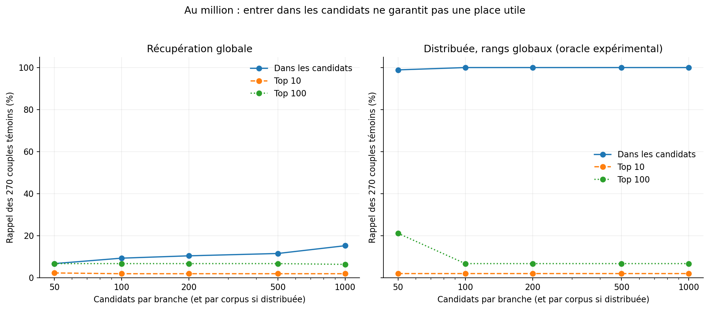

# Profondeur et récupération distribuée

La distribuée prend L candidats par corpus et par branche, puis conserve les rangs globaux originaux dans RRF. Aucun rang de corpus n'est remis à 1. Les rangs globaux exacts sont disponibles ici grâce au calcul exhaustif : c'est un oracle expérimental, pas une capacité acquise pour une fédération d'index distants.

## Au million de réponses

| Stratégie | L | Témoins candidats /270 | Top10 /270 | Top20 /270 | Top50 /270 | Top100 /270 | Candidats moyens | Fusion moyenne (ms) |
|---|---:|---:|---:|---:|---:|---:|---:|---:|
| global | 50 | 18 | 6 | 10 | 14 | 18 | 95.1 | 0.49 |
| distributed_global_ranks | 50 | 267 | 5 | 11 | 14 | 57 | 168.4 | 0.57 |
| global | 100 | 25 | 5 | 9 | 14 | 18 | 190.3 | 0.65 |
| distributed_global_ranks | 100 | 270 | 5 | 10 | 14 | 18 | 321.9 | 1.06 |
| global | 200 | 28 | 5 | 6 | 14 | 18 | 382.0 | 1.34 |
| distributed_global_ranks | 200 | 270 | 5 | 6 | 14 | 18 | 604.7 | 2.81 |
| global | 500 | 31 | 5 | 6 | 14 | 18 | 951.5 | 3.35 |
| distributed_global_ranks | 500 | 270 | 5 | 6 | 14 | 18 | 1220.8 | 4.84 |
| global | 1000 | 41 | 5 | 6 | 14 | 17 | 1900.8 | 7.73 |
| distributed_global_ranks | 1000 | 270 | 5 | 6 | 14 | 18 | 2170.0 | 8.12 |

## Tous les paliers, tous les budgets

| Réponses 2019 | Stratégie | L | Témoins candidats | Top10 | Top100 |
|---:|---|---:|---:|---:|---:|
| 240 | global | 50 | 235 | 90 | 235 |
| 240 | distributed_global_ranks | 50 | 267 | 91 | 248 |
| 240 | global | 100 | 261 | 91 | 248 |
| 240 | distributed_global_ranks | 100 | 270 | 91 | 249 |
| 240 | global | 200 | 269 | 91 | 248 |
| 240 | distributed_global_ranks | 200 | 270 | 91 | 249 |
| 240 | global | 500 | 270 | 91 | 245 |
| 240 | distributed_global_ranks | 500 | 270 | 91 | 245 |
| 240 | global | 1000 | 270 | 91 | 245 |
| 240 | distributed_global_ranks | 1000 | 270 | 91 | 245 |
| 1,000 | global | 50 | 163 | 54 | 163 |
| 1,000 | distributed_global_ranks | 50 | 267 | 61 | 204 |
| 1,000 | global | 100 | 206 | 56 | 175 |
| 1,000 | distributed_global_ranks | 100 | 270 | 56 | 200 |
| 1,000 | global | 200 | 249 | 56 | 174 |
| 1,000 | distributed_global_ranks | 200 | 270 | 56 | 187 |
| 1,000 | global | 500 | 267 | 56 | 178 |
| 1,000 | distributed_global_ranks | 500 | 270 | 56 | 178 |
| 1,000 | global | 1000 | 270 | 56 | 177 |
| 1,000 | distributed_global_ranks | 1000 | 270 | 56 | 177 |
| 5,000 | global | 50 | 88 | 23 | 88 |
| 5,000 | distributed_global_ranks | 50 | 267 | 38 | 132 |
| 5,000 | global | 100 | 117 | 28 | 93 |
| 5,000 | distributed_global_ranks | 100 | 270 | 31 | 109 |
| 5,000 | global | 200 | 161 | 29 | 90 |
| 5,000 | distributed_global_ranks | 200 | 270 | 29 | 98 |
| 5,000 | global | 500 | 222 | 29 | 91 |
| 5,000 | distributed_global_ranks | 500 | 270 | 29 | 92 |
| 5,000 | global | 1000 | 250 | 29 | 89 |
| 5,000 | distributed_global_ranks | 1000 | 270 | 29 | 90 |
| 20,000 | global | 50 | 60 | 19 | 60 |
| 20,000 | distributed_global_ranks | 50 | 267 | 22 | 90 |
| 20,000 | global | 100 | 79 | 14 | 61 |
| 20,000 | distributed_global_ranks | 100 | 270 | 16 | 66 |
| 20,000 | global | 200 | 97 | 14 | 61 |
| 20,000 | distributed_global_ranks | 200 | 270 | 15 | 65 |
| 20,000 | global | 500 | 130 | 14 | 62 |
| 20,000 | distributed_global_ranks | 500 | 270 | 14 | 65 |
| 20,000 | global | 1000 | 176 | 14 | 62 |
| 20,000 | distributed_global_ranks | 1000 | 270 | 14 | 64 |
| 100,000 | global | 50 | 30 | 9 | 30 |
| 100,000 | distributed_global_ranks | 50 | 267 | 13 | 69 |
| 100,000 | global | 100 | 39 | 8 | 30 |
| 100,000 | distributed_global_ranks | 100 | 270 | 10 | 32 |
| 100,000 | global | 200 | 59 | 7 | 31 |
| 100,000 | distributed_global_ranks | 200 | 270 | 7 | 31 |
| 100,000 | global | 500 | 79 | 7 | 31 |
| 100,000 | distributed_global_ranks | 500 | 270 | 7 | 31 |
| 100,000 | global | 1000 | 95 | 7 | 31 |
| 100,000 | distributed_global_ranks | 1000 | 270 | 7 | 31 |
| 1,000,000 | global | 50 | 18 | 6 | 18 |
| 1,000,000 | distributed_global_ranks | 50 | 267 | 5 | 57 |
| 1,000,000 | global | 100 | 25 | 5 | 18 |
| 1,000,000 | distributed_global_ranks | 100 | 270 | 5 | 18 |
| 1,000,000 | global | 200 | 28 | 5 | 18 |
| 1,000,000 | distributed_global_ranks | 200 | 270 | 5 | 18 |
| 1,000,000 | global | 500 | 31 | 5 | 18 |
| 1,000,000 | distributed_global_ranks | 500 | 270 | 5 | 18 |
| 1,000,000 | global | 1000 | 41 | 5 | 17 |
| 1,000,000 | distributed_global_ranks | 1000 | 270 | 5 | 18 |

À L égal, le budget total de la distribuée est plus élevé. Au million, distribuée50 utilise 168,4 candidats moyens contre 95,1 pour globale50 ; globale100 utilise 190,3. Comparer seulement un taux de couverture à L égal surestimerait la spécificité du gain. Les témoins ajoutés ne sont pas nécessairement mieux classés face à tous les contemporains exclus du petit pool.

