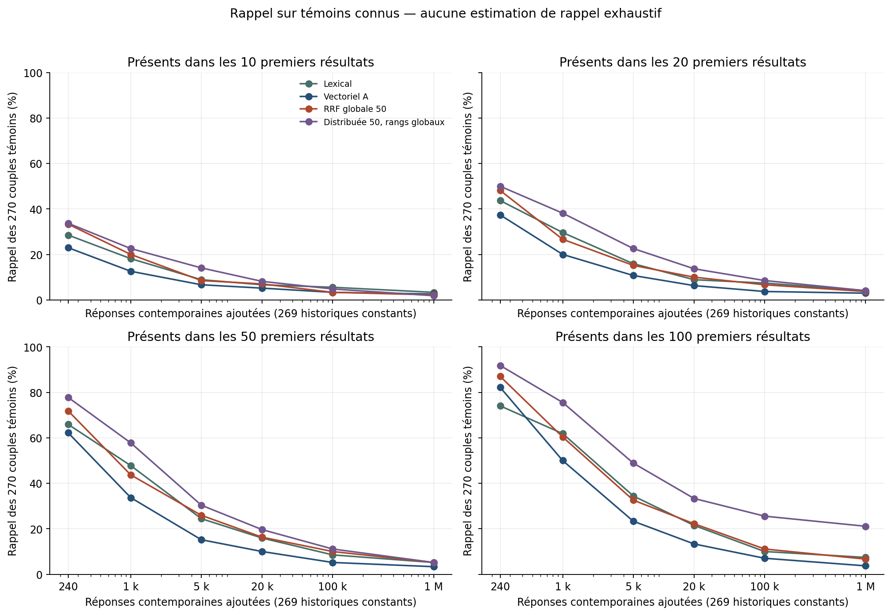

# Croissance et rappel des témoins connus

270 associations requête–article de note ≥2 héritées, couvrant 135 articles distincts et 21 requêtes. Ce n'est pas un rappel exhaustif. Les neuf requêtes sans témoin historique n'ajoutent pas de dénominateur artificiel.

| Réponses 2019 | Méthode | Top10 | Top20 | Top50 | Top100 |
|---:|---|---:|---:|---:|---:|
| 240 | BM25 | 77 (28.5 %) | 118 (43.7 %) | 178 (65.9 %) | 200 (74.1 %) |
| 240 | BGE-M3 A exact | 62 (23.0 %) | 101 (37.4 %) | 168 (62.2 %) | 222 (82.2 %) |
| 240 | RRF globale50 | 90 (33.3 %) | 130 (48.1 %) | 194 (71.9 %) | 235 (87.0 %) |
| 1,000 | BM25 | 49 (18.1 %) | 80 (29.6 %) | 129 (47.8 %) | 167 (61.9 %) |
| 1,000 | BGE-M3 A exact | 34 (12.6 %) | 54 (20.0 %) | 91 (33.7 %) | 135 (50.0 %) |
| 1,000 | RRF globale50 | 54 (20.0 %) | 72 (26.7 %) | 118 (43.7 %) | 163 (60.4 %) |
| 5,000 | BM25 | 24 (8.9 %) | 43 (15.9 %) | 66 (24.4 %) | 93 (34.4 %) |
| 5,000 | BGE-M3 A exact | 18 (6.7 %) | 29 (10.7 %) | 41 (15.2 %) | 63 (23.3 %) |
| 5,000 | RRF globale50 | 23 (8.5 %) | 41 (15.2 %) | 70 (25.9 %) | 88 (32.6 %) |
| 20,000 | BM25 | 18 (6.7 %) | 24 (8.9 %) | 43 (15.9 %) | 58 (21.5 %) |
| 20,000 | BGE-M3 A exact | 14 (5.2 %) | 17 (6.3 %) | 27 (10.0 %) | 36 (13.3 %) |
| 20,000 | RRF globale50 | 19 (7.0 %) | 27 (10.0 %) | 44 (16.3 %) | 60 (22.2 %) |
| 100,000 | BM25 | 15 (5.6 %) | 20 (7.4 %) | 23 (8.5 %) | 27 (10.0 %) |
| 100,000 | BGE-M3 A exact | 9 (3.3 %) | 10 (3.7 %) | 14 (5.2 %) | 19 (7.0 %) |
| 100,000 | RRF globale50 | 9 (3.3 %) | 18 (6.7 %) | 27 (10.0 %) | 30 (11.1 %) |
| 1,000,000 | BM25 | 9 (3.3 %) | 11 (4.1 %) | 14 (5.2 %) | 20 (7.4 %) |
| 1,000,000 | BGE-M3 A exact | 7 (2.6 %) | 8 (3.0 %) | 9 (3.3 %) | 10 (3.7 %) |
| 1,000,000 | RRF globale50 | 6 (2.2 %) | 10 (3.7 %) | 14 (5.2 %) | 18 (6.7 %) |

## Composition de la première page

Moyenne sur les 30 requêtes, résultats historiques de tout niveau de pertinence. Une baisse de cette part ne constitue pas en soi une erreur.

| Réponses 2019 | BM25 | Vectoriel A | RRF globale50 | Distribuée50 |
|---:|---:|---:|---:|---:|
| 240 | 5.00 | 3.20 | 4.50 | 4.57 |
| 1,000 | 2.73 | 1.77 | 2.50 | 2.87 |
| 5,000 | 1.27 | 0.67 | 0.93 | 1.57 |
| 20,000 | 0.73 | 0.47 | 0.67 | 0.87 |
| 100,000 | 0.53 | 0.30 | 0.30 | 0.47 |
| 1,000,000 | 0.30 | 0.23 | 0.20 | 0.17 |

Sources : [métriques agrégées](data/summary.json), [par requête](data/per-query-metrics.json), [suivi complet](data/witness-tracking.jsonl.gz).
