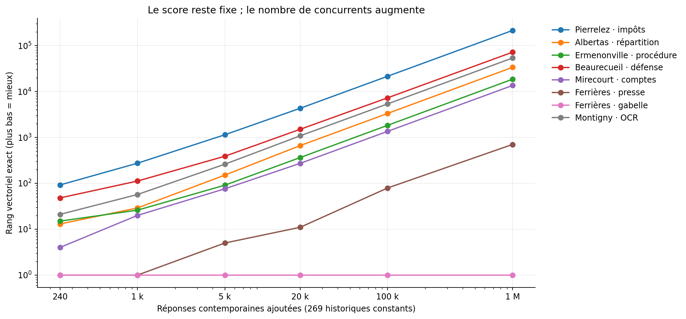

# Recherche multicorpus : effet du passage à un million de réponses

Étude exécutée le 26 octobre 2026, exclusivement sur des fichiers et bases locales en lecture seule. **269 articles historiques, six populations contemporaines emboîtées de 240 à 1 000 000 unités, 30 requêtes inchangées. Aucun nouvel embedding ni changement applicatif.**

Les témoins historiques reculent fortement lorsque le corpus contemporain grandit. La récupération globale RRF avec 50 candidats par branche conserve 235 des 270 couples requête–article pertinents connus parmi ses candidats à la référence, puis 18 au million. Une récupération distribuée retrouve presque tous ces témoins, mais **ne démontre aucun gain en première page au million**. La croissance apporte également de nombreuses réponses contemporaines réellement pertinentes. La disparition des textes historiques ne peut donc pas être interprétée intégralement comme une erreur du moteur.

Les résultats soutiennent le maintien d'une liste commune sans quotas. Ils ne permettent pas de choisir définitivement une architecture de récupération : couverture des candidats et pertinence finale doivent être validées séparément.

## Livrables

| Document | Contenu |
|---|---|
| [Croissance](GROWTH.md) | Tous les paliers, rappel des témoins aux profondeurs 10/20/50/100, composition des résultats |
| [Profondeurs](DEPTHS.md) | Budgets 50/100/200/500/1 000, récupération globale et distribuée |
| [Galerie](GALLERY.md) | Onze cas historiques, textes contemporains concurrents, quatre contre-exemples |
| [Pertinence](QUALITY.md) | Jugements exploratoires, comparaison des premières pages réellement relues |
| [Performance](PERFORMANCE.md) | Temps, mémoire, stockage ; coûts hors ligne et par recherche distingués |
| [Architecture](ARCHITECTURE.md) | Options, limites du classement distribué, prochaine validation |
| [Données et reproduction](DATA.md) | Scripts, schémas, dépendances, reprise sans base ni recalcul des vecteurs |

Les fichiers de [données](data/) contiennent notamment les identifiants du million d'unités, les 2 160 classements, 19 440 lignes de suivi de témoins, les branches brutes et les annotations. Cinq graphiques sont disponibles en PNG, SVG et PDF dans [figures](figures/).

## Ressources réellement disponibles

L'[inventaire mesuré](data/inventory.json) distingue les réponses métier des unités admissibles à la recherche :

| Ressource locale | Unités / réponses | Vecteurs | Population |
|---|---:|---:|---|
| Base métier `cahier_doleances_local` | 15 792 750 réponses ; 1 589 285 contributions | Sans correspondance vectorielle universelle présumée | Ensemble local, comprenant des réponses non retenues par l'adaptateur de recherche |
| Espace `rag_full`, vérifié | 5 172 356 unités | 5 187 190 | Unités utilisables de l'adaptateur GDN, arrêtées à `max_answer_id=15915250` |
| Espace `pilot100k` | 100 000 | 100 258 | Hachage des parents puis arrêt aux premières unités ; pas un tirage national uniforme |
| Ancien ensemble RAG-007/013 | 20 000 | 20 067 | Union de jeux de développement enrichis ; pas représentatif par construction |
| Première expérience sémantique | 240 contemporaines + 269 historiques | Réutilisés intégralement | 60 réponses par questionnaire contemporain ; sélection antérieure protégée |
| Nouvelle expérience | 1 000 000 contemporaines + 269 historiques | 1 003 055 segments contemporains | Extension aléatoire déterministe de la référence depuis `rag_full` |

Les vecteurs `full` sont compatibles avec le modèle et la recette contemporaine étudiés : BGE-M3 figé, dimension 1 024, CLS, L2, représentation question/réponse B, budget 1 024 tokens, chevauchement 128, calcul bfloat16 puis stockage float32. Le manifeste, les empreintes de recette et de chaîne sont conservés. Chaque vecteur exporté est vérifié contre son empreinte stockée.

**Le palier d'un million est une borne volontaire du pilote, fixée avant les calculs.** Des vecteurs existent au-delà ; cette étude ne mesure pas les 5,17 millions d'unités. Le coût prévu d'environ 4,1 Go de vecteurs et une enveloppe de travail de 12 Gio étaient raisonnables sur la machine locale : Ryzen 7950X, environ 124 Gio de RAM, plus de 117 Gio disponibles et 1,2 Tio de disque libre au départ. Aucune charge de production n'est utilisée. Les lectures SQL sont séquentielles et bornées ; aucune infrastructure ANN n'est créée.

## Populations et biais

Le [protocole](protocol.json) et les [empreintes de préenregistrement](preregistration.json) sont figés avant l'examen des nouveaux classements. Les formulations des 30 requêtes sont copiées octet pour octet. Les paramètres ne sont pas optimisés sur leurs résultats.

Les 240 réponses et leurs vecteurs d'origine restent au début de chaque population. Une permutation des ordinaux `1..5 172 356`, par NumPy PCG64 de graine `17892019`, fournit ensuite les 999 760 autres unités, en évitant les 240 déjà présentes. Chaque palier prend un préfixe du même ordre. Le tirage est indépendant des requêtes et uniforme au niveau des unités supplémentaires, conditionnellement à la référence protégée.

Nous avons écarté l'extension de l'ancien lot de développement enrichi, susceptible de surreprésenter certains thèmes, et le lot `pilot100k`, insuffisant et sélectionné selon une autre recette. Le nouveau palier 20 000 **n'est pas** l'ancien ensemble RAG-013 de même taille.

| Réponses 2019 | Parents distincts | Réponses supplémentaires d'un même parent | Questionnaires 4 / 5 / 7 / 10 |
|---:|---:|---:|---|
| 240 | 240 | 0 | 60 / 60 / 60 / 60 |
| 1 000 | 999 | 1 | 193 / 373 / 200 / 234 |
| 5 000 | 4 963 | 37 | 875 / 2 029 / 1 015 / 1 081 |
| 20 000 | 19 502 | 498 | 3 381 / 8 132 / 3 914 / 4 573 |
| 100 000 | 87 824 | 12 176 | 16 724 / 40 990 / 20 011 / 22 275 |
| 1 000 000 | 406 475 | 593 525 | 165 456 / 411 719 / 200 979 / 221 846 |

Les réponses distinctes d'une contribution restent admissibles : une seule réponse par parent changerait la population et limiterait artificiellement le grand palier. Les identifiants d'unités sont uniques. Les textes identiques de réponses différentes ne sont pas supprimés : 107 036 occurrences supplémentaires d'un texte déjà présent au million. Cela peut renforcer la concurrence entre réponses courtes ou répétées. Ni la représentativité des citoyens, ni une représentativité géographique ne sont démontrées. Les formulaires les plus fournis pèsent naturellement davantage ; le corpus historique reste petit et sélectionné documentairement. Une seule réalisation aléatoire ne mesure pas la variance entre tirages.

## Méthodes exécutées

La configuration du moteur a été relue à la révision applicative `818b5464f24cac4d8537793c15c8e2c580505f88` ; les observations de l'[audit du moteur](../1789-semantic-search/ENGINE.md) restent applicables. Aucun service public n'a été interrogé.

- **Vectoriel exact** : BGE-M3 `5617a9f61b028005a4858fdac845db406aefb181`, cosinus global, maximum par unité lorsqu'elle possède plusieurs segments. Les articles historiques utilisent A, texte seul ; aucune modernisation. Les requêtes et les vecteurs historiques sont ceux de la première expérience.
- **Lexical** : même BM25 autonome que l'expérience précédente, Snowball français, `k1=1,2`, `b=0,75`, réponses seules. Longueurs et fréquences documentaires sont recalculées sur toute la population de chaque palier, historiques inclus. Le cache conserve les fréquences des seuls termes nécessaires aux requêtes figées, ce qui donne le même score que le calcul complet pour ces requêtes.
- **Hybride** : RRF de constante 60, poids égaux, fractions exactes, départage par identifiant. Un document contribue uniquement dans les branches qui le récupèrent. Cinq limites de candidats sont testées, sans bonus de corpus ou de date.
- **Distribuée** : top L de chaque branche dans chaque corpus, puis classement commun utilisant les **rangs globaux originaux**, et non des rangs remis à 1 dans chaque corpus. Cette variante teste la couverture sans accorder mécaniquement le même poids aux premiers de deux populations très différentes. Les rangs globaux exacts sont ici un oracle obtenu par balayage exhaustif : leur coût dans une architecture fédérée n'est pas résolu.

Les 90 top 10 de référence — 30 requêtes × lexical, vectoriel A et hybride A globale 50 — sont identiques à la première expérience. Les 240 vecteurs contemporains de référence restent ceux de l'archive ; leurs homologues recalculés antérieurement dans `full` présentent de légères différences numériques, malgré la même recette. Sur ces 240 contrôles, cosinus entre versions ≥0,999742 et variation maximale d'une similarité de requête de 0,003921. Ce constat n'est pas une borne garantie pour les autres vecteurs.

Le BM25 expérimental **ne reproduit pas** le lexical PostgreSQL public, qui utilise une autre formule (`h1-public-v2-ts-rank`). De même, le calcul exact ne mesure pas les pertes d'un HNSW. L'inférence des requêtes est déjà faite ; les temps excluent son coût.

## Témoins et résultats de croissance

L'ensemble témoin comprend **tous les jugements historiques existants de note 2 ou 3** : 270 associations requête–article, 135 articles distincts, 21 requêtes. Il inclut des articles courts, longs, dégradés par l'OCR, bien ou mal classés. Ce sont des jugements exploratoires antérieurs, conservés sans modification. Ils ne constituent pas une vérité exhaustive : le dénominateur est constitué des témoins connus, pas de toutes les réponses pertinentes possibles.

| Réponses 2019 | Témoins candidats RRF globale 50 | Top 10 | Top 20 | Top 50 | Top 100 |
|---:|---:|---:|---:|---:|---:|
| 240 | 235 | 90 | 130 | 194 | 235 |
| 1 000 | 163 | 54 | 72 | 118 | 163 |
| 5 000 | 88 | 23 | 41 | 70 | 88 |
| 20 000 | 60 | 19 | 27 | 44 | 60 |
| 100 000 | 30 | 9 | 18 | 27 | 30 |
| 1 000 000 | 18 | 6 | 10 | 14 | 18 |

Au million, le rappel sur témoins connus est donc de **2,2 % / 3,7 % / 5,2 % / 6,7 %** aux profondeurs 10/20/50/100 en RRF globale 50. Parmi les 235 couples initialement récupérables par cette méthode, 217 sortent du pool ; 35 autres étaient déjà absents à la référence. Les cosinus historiques restent exactement constants, mais leur rang vectoriel recule lorsque de nouveaux documents obtiennent un score supérieur. Les scores BM25, eux, changent avec les IDF et la longueur moyenne du corpus.

La gabelle de Ferrières reste première en vectoriel et hybride au million. À l'inverse, l'équité fiscale d'Albertas passe du rang vectoriel 13 à 33 692 ; la responsabilité des ministres à Mirecourt de 4 à 13 567. La modération des impositions de Pierrelez était déjà hors des 50 premiers candidats à la référence : tout défaut observé au million n'est pas créé par la croissance.

### Couverture et classement final sont différents

Au million, passer de 50 à 1 000 candidats globaux par branche augmente la couverture de **18 à 41 témoins**, mais le top 10 passe de 6 à 5, et le top 100 de 18 à 17. La presse de Ferrières est retrouvée au rang vectoriel 703, puis classée 1 289e en RRF globale 1 000. À 20 000 réponses, certains gains existent : un article fiscal de Vie, absent du pool 50, devient 76e avec 1 000 candidats. Ils ne justifient pas une hausse uniforme des seuils.

La distribuée à L=50 récupère **267/270 témoins**, mais en place 5 dans le top 10 au million, contre 6 en globale. Son top 100 contient 57 témoins, contre 18 ; ce gain doit être interprété avec prudence. Elle examine en moyenne 168,4 candidats contre 95,1 en globale 50. Le petit pool contemporain omet aussi des concurrents possibles : son apparent gain de rang historique peut provenir de cette omission. Quand la profondeur augmente, la distribuée ne conserve que 18 témoins dans le top 100. Même à budget voisin — globale 100, 190,3 candidats — la différence de couverture ne prouve pas une meilleure pertinence finale.

## Ce qui explique les reculs

| Situation | Observation vérifiée | Limite de l'interprétation |
|---|---|---|
| A — Concurrence pertinente | Des réponses contemporaines demandant explicitement des comptes aux élus précèdent Mirecourt ; la fiscalité fournit également de nombreux résultats notés 3 | La même note 3 ne prouve pas que chaque réponse moderne est strictement meilleure ; aucune proportion globale de « concurrence légitime » n'est calculable avec des jugements partiels |
| B — Perte de récupération | Albertas et Ermenonville sortent du top 50 vectoriel ; 217 couples initialement candidats sont exclus au million | Une exclusion technique et une concurrence pertinente peuvent se produire simultanément |
| C — Fusion défectueuse | Sur les frais de justice, Mirecourt est vectoriel 28 mais RRF 53 ; une réponse sur les transports moins chers, notée 0, devient RRF 7 grâce au lexical 3 | Ce cas concerne aussi la recette lexicale expérimentale ; il ne démontre pas le même défaut exact dans le service public |
| D — Effet de représentation | Le contrôle apparié ci-dessous constate des déplacements de scores et de rangs quand une question est ajoutée à une même réponse | Pas de preuve d'incompatibilité technique ni de pénalité historique uniforme ; l'effet n'est pas isolé au million |

Le [diagnostic secondaire apparié](data/context-control.json), explicitement ajouté après les premiers classements, réutilise les vecteurs A/B de **510 mêmes réponses complètes**, sans nouveau calcul d'embeddings. Question et réponse, modèle, précision bfloat16 et périmètre sont contrôlés. L'ajout de la question change la similarité moyenne de +0,00687 ; 121 couples témoins reculent, 124 avancent et 25 restent stables. Leur rang moyen passe de 83,26 à 85,29. La contextualisation a un effet, mais il est bidirectionnel. Cette cohorte de développement enrichie ne permet pas de calibrer les deux corpus au million. Les classements principaux restent inchangés. Les variantes historiques B déjà encodées sont également conservées en diagnostic, sans remplacer A.

## Pertinence réellement examinée

Dix requêtes fixées avant les nouveaux classements couvrent six thèmes positifs et quatre contre-exemples. Le pool rassemble les top 10 des principales méthodes aux deux extrémités : **445 couples jugés**, dont 215 jugements antérieurs inchangés et 230 nouveaux jugements exploratoires Codex. Les textes complets et questions associés sont conservés ; les nouveaux textes ont été relus sans afficher rang ni score dans le dossier de lecture. Cette précaution ne rend pas le jugement indépendant. La durée humaine de validation n'a pas été chronométrée et n'est pas estimée.

| Méthode, dix requêtes relues | Note moyenne /3 à 240 | Note moyenne /3 au million | Résultats utiles au million /100 |
|---|---:|---:|---:|
| BM25 | 1,06 | 2,06 | 70 |
| Vectoriel A | 1,56 | 2,57 | 81 |
| RRF globale 50 | 1,42 | 2,49 | 84 |
| RRF distribuée 50 | 1,42 | 2,49 | 84 |
| RRF globale 1 000 | 1,41 | 2,48 | 81 |

Sur ces dix requêtes au million, globale et distribuée 50 ont les mêmes premières pages. La baisse du rappel historique s'accompagne donc d'une amélioration de la pertinence moyenne dans ce sous-ensemble, sans prouver que tous les documents historiques relégués sont moins utiles.

Les faux amis historiques des quatre contre-exemples — classes scolaires, coopération entre États, fibre, cyberattaques — disparaissent naturellement du top 10 au million. Des demandes explicites de fibre rurale et de baisse des effectifs scolaires les remplacent. Mais la coopération internationale reste confondue avec la coordination entre administrations ; la RRF sur les cyberattaques conserve des textes de lutte contre la drogue ou la fraude fiscale. Les notes 0 et 1 restent distinctes. Aucun filtre de période n'a été appliqué.

Les mesures de pertinence ne portent pas sur les 20 autres requêtes au million, ni sur tous les documents qui dépassent les témoins. Il n'est pas possible d'attribuer un pourcentage fiable des reculs aux quatre causes. Les moyennes par méthode n'ont pas de portée statistique nationale.

## Coûts et périmètre de validité

L'export en lecture seule a duré 283,80 s ; la tokenisation/statistique lexicale 16,65 s. Les 30 calculs vectoriels complets ont pris 2,68 s, hors tris, sans encodage. Au million, une recherche fraîche sur les vecteurs existants demande environ 88,5 ms de cosinus/agrégation et 81,8 ms de tri vectoriel ; BM25 et son tri environ 80,4 et 31,7 ms. Ce sont des médianes sur trois requêtes, caches chauds, quatre threads BLAS, sans réseau ni modèle. Les fusions vont d'environ 0,49 ms en globale 50 à 8,12 ms en distribuée 1 000. Les ressources détaillées sont dans [PERFORMANCE.md](PERFORMANCE.md).

Le cache isolé occupe 4,82 Gio, dont 3,83 Gio de vecteurs bruts. Le RSS observé après le grand palier est 4,25 Gio ; ce n'est pas un pic indépendant par requête. Les mesures ne prédisent ni latence PostgreSQL/HNSW, ni débit multiutilisateur, ni coût d'un moteur fédéré.

Les contrôles rejouent sans base les 1 800 fusions, vérifient 16 200 suivis hybrides, l'unicité et l'emboîtement des populations, la constance des cosinus historiques, le protocole et les requêtes figés. Les 225 fichiers des audits précédents sont inchangés ; aucun fichier applicatif suivi n'a été modifié. Voir [les contrôles exécutés](data/checks.json) et [la reproduction](DATA.md).

## Réponses aux questions finales

**Q1. Évolution des rangs ?** Recul marqué, variable selon les thèmes : le rappel historique connu du top 10 RRF 50 passe de 33,3 % à 2,2 %. La gabelle reste première ; plusieurs demandes contemporanément formulées descendent de milliers de rangs.

**Q2. Concurrence ou récupération ?** Les deux sont observées. La sortie de 217 couples du pool est mesurée ; de nombreux concurrents modernes sont pertinents. Les annotations ne permettent pas de déterminer une cause majoritaire en pertinence réelle.

**Q3. Accessibilité aux premières profondeurs ?** Au million, RRF globale 50 : 6/270, 10/270, 14/270 et 18/270 dans les top 10/20/50/100, soit 2,2/3,7/5,2/6,7 %. [Toutes les méthodes](GROWTH.md).

**Q4. Augmenter les candidats ?** Gain de couverture de 18 à 41 au million entre L=50 et 1 000, sans gain du top 10 ni du top 100. Quelques gains existent aux paliers intermédiaires. Aucune hausse générale n'est justifiée par ces seules données.

**Q5. L'hybride reste-t-il pertinent ?** Sur les dix requêtes relues, 84 résultats utiles sur 100 au million, contre 81 en vectoriel et 70 en BM25 ; sa note moyenne est toutefois inférieure au vectoriel (2,49 contre 2,57). Il conserve des faux positifs lexicaux. Il reste une option, pas une supériorité universelle démontrée.

**Q6. Avantage distribué démontré ?** Oui pour la disponibilité des témoins parmi les candidats ; non pour la première page au million. Le gain du top 100 à faible profondeur est sensible aux omissions du pool et au budget supérieur. Le classement commun nécessite ici des rangs globaux exacts.

**Q7. Faux rapprochements historiques ?** Ils reculent et disparaissent du top 10 des quatre contre-exemples au million. Certains faux rapprochements modernes persistent. Pas de conclusion sur toutes les requêtes possibles.

**Q8. Modèle, fusion ou corpus ?** Les cosinus constants montrent la concurrence de nouveaux scores vectoriels ; les faibles rangs de Pierrelez préexistent. La fusion peut dégrader un bon résultat vectoriel ; BM25 varie avec les IDF. Les différences A/B ont un effet mesuré mais non uniforme. OCR et longueur restent des facteurs possibles, non isolés causalement.

**Q9. Coûts des architectures ?** Les pools distribués sont plus grands et multiplieraient les récupérations par le nombre de corpus ; les fusions restent modestes ici. L'obtention des rangs globaux et un éventuel reclassement commun ajoutent un coût non mesuré en production. Les balayages exacts locaux ne sont pas une prévision du service.

**Q10. Liste unique sans quotas ?** Oui, les deux stratégies testées la conservent. La référence globale reste la plus simple ; une récupération plus large ou distribuée peut alimenter un classement commun, à condition de ne pas réinitialiser les rangs par corpus et de démontrer sa valeur finale.

**Q11. Suffisant pour intégrer ?** Suffisant pour identifier les risques, écarter l'idée qu'un gain de candidats garantit un gain de pertinence et préparer un protocole. Insuffisant pour modifier le moteur : une graine, 269 articles et des jugements partiels ne valident pas la recherche multicorpus complète.

**Q12. Prochaine expérience ?** Une validation limitée du rappel des candidats et du classement avec la recette lexicale publique et l'ANN locale, plusieurs tirages, requêtes de validation distinctes et jugement humain indépendant des documents réellement concurrents. Comparer les budgets globaux et distribués à coût voisin ; garder un classement commun sans quotas. [Mission proposée, non commencée](ARCHITECTURE.md).
