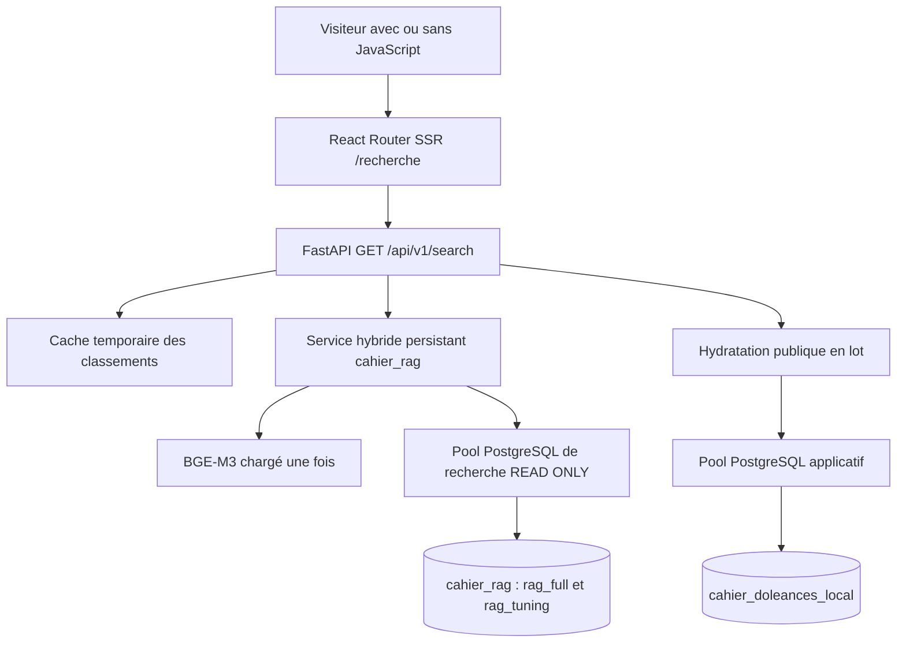

# SEARCH-002 — Architecture d’intégration de la recherche hybride

Rapport de conception du 20 octobre 2026. Périmètre : Hal9000 local uniquement.

## 1. Résumé exécutif

**Conserver les deux bases et intégrer une façade de recherche persistante dans FastAPI.** `cahier_doleances_local` reste la référence applicative et publique ; `cahier_rag` fournit les candidats et leur classement. React continue à accéder uniquement à FastAPI, via son serveur SSR.

Le moteur général sera exclusivement hybride : lexical optimisé RAG-027, BGE-M3 dense/HNSW et RRF. Il remplace les recherches générales de réponses et de catalogue. Aucun sélecteur de moteur, feature flag, fallback historique, génération, assemblage de contexte ou reranker ne sera introduit. Les pages documentaires et leurs services restent conservés.

Pour une première version, retenir le profil interactif déjà utilisé : profondeur **50 par branche**, lexical à statistiques exactes figées sans préfiltrage approximatif, HNSW **ef1000/400 candidats**, fusion non pondérée **k=60**, puis les **50 premiers documents fusionnés**. Regrouper ensuite par réponse historique pour l’affichage, sans additionner les scores de ses différents documents. Cela donne au plus 50 réponses consultables, par pages de 20, sans prétendre paginer exhaustivement 5,17 millions de documents.

Le classement est conservé temporairement côté serveur. Les liens de pagination portent un curseur opaque ; aucune nouvelle inférence ni recherche SQL de classement n’est nécessaire pour les pages suivantes. La limite et l’expiration sont annoncées aux visiteurs.

Deux réserves conditionnent la validation publique :

- RAG-027 a retenu ef1000 comme compromis interactif, mais **aucun profil ANN n’a satisfait ses seuils de qualification**. L’intégration ne transforme pas ce compromis en validation générale du rappel.
- Le coût réel de l’encodage persistant et de recherches concurrentes reste à vérifier dans les tickets d’implémentation. Les mesures existantes ne sont pas un SLA public.

Ce rapport remplace les suggestions de désactivation/retour arrière du scénario B de SEARCH-001 : la décision fonctionnelle actuelle exclut tout retour automatique à l’ancien moteur.

## 2. Méthode et limites des constats

Analyse statique des fichiers cités et des rapports [SEARCH-001](audit-search-001.md) et [RAG-027](../rag/rapport-rag-027.md). Les volumes, identités PostgreSQL, droits locaux et états d’index proviennent de SEARCH-001 ; ils n’ont pas été remesurés ici. Aucun accès SQL, modèle, benchmark, test susceptible d’écrire, migration ou commande distante n’a été exécuté pour SEARCH-002.

Les valeurs proposées ci-dessous sont des choix de conception à vérifier, distincts des réglages effectivement présents. Seul ce rapport est créé ; aucun code, paramètre ou objet PostgreSQL n’est modifié.

## 3. Architecture recommandée et connexions

### 3.1. Répartition des responsabilités



La façade du package `cahier_rag` reçoit une requête, un encodeur injecté, un accès de lecture et une échéance. Elle retourne un classement documentaire indépendant de FastAPI. Une couche applicative restreinte gère validation HTTP, regroupement par réponse, cache, hydratation et projection publique. Pas de framework de connecteurs ni de service génératif intermédiaire.

Pour Hal9000, recommander **un processus FastAPI avec une instance de modèle**, et un exécuteur borné pour le travail bloquant. Ce choix doit être explicite dans le futur lancement local : plusieurs workers impliqueraient plusieurs modèles et caches distincts. Une extraction future de l’encodeur dans un processus persistant partagé reste possible sans modifier le contrat HTTP ; elle n’est pas requise en V1.

### 3.2. Deux moteurs SQLAlchemy indépendants

| Accès | Destination | Responsabilités | Cycle de vie proposé |
|---|---|---|---|
| Applicatif actuel | `cahier_doleances_local` | Contributions, questions, formulaires, auteurs, statistiques, comptes, authentification, favoris et hydratation | Conserver `app/db.py`, `SessionLocal` et les droits applicatifs nécessaires |
| Recherche publique nouveau | `cahier_rag` | Lecture des manifestes, documents, segments, statistiques lexicales et classement | Moteur distinct, transactions READ ONLY, pool réduit, fermé au shutdown |
| Maintenance RAG existante | `cahier_rag`, source séparée | Imports, vérification, indexation, migrations expérimentales | Hors processus et hors identifiants du service public |

Le service ne doit jamais substituer `cahier_rag` à `DATABASE_URL`. Prévoir une URL de recherche explicite, sans résolution implicite par `TEST_DATABASE_URL`, `DATABASE_URL` ou un chemin de campagne. Les tests auront deux URL explicites vers deux bases isolées. Ne pas partager de session ORM ou de transaction entre moteurs. Aucune transaction distribuée, FDW ou jointure interbases n’est nécessaire.

Point de départ local proposé : pool recherche de taille 2, sans overflow ; admission d’un calcul hybride à la fois et au plus deux requêtes en attente. Les pages servies depuis un classement utilisent seulement le pool applicatif. Ne jamais garder une connexion SQL pendant l’encodage, l’attente d’admission ou la sérialisation. Commencer avec les branches SQL séquentielles, comme le parcours existant ; leur parallélisation n’est pas indispensable et augmenterait la pression sur PostgreSQL.

### 3.3. Lecture seule et protections

[`create_source_engine` et `source_connection`](../rag/src/cahier_rag/db.py) imposent déjà READ ONLY à la source. En revanche, `create_rag_engine` et [`DatabaseGuard.transaction`](../rag/src/cahier_rag/safety.py) ne l’imposent pas à la destination : ce garde sert aussi aux écritures de maintenance. Il contrôle l’identité physique, la distinction source/cible et l’absence de schéma applicatif dans la cible. **Utiliser ce garde ne suffit donc pas à obtenir un accès public en lecture seule.**

Adaptation recommandée : fournir un accès de recherche étroit, avec le protocole de lecture attendu par les composants réutilisés (`transaction`, lecture d’état), qui applique READ ONLY avant toute requête et conserve les vérifications de destination. Il peut composer le contrôle d’identité existant ; il ne doit pas exposer les méthodes d’écriture de `FullStore` dans son interface publique. Ne pas modifier le comportement permissif nécessaire aux opérations de maintenance, ni supprimer leurs garde-fous. Ne pas charger les millions de documents pour vérifier le manifeste.

Au démarrage, vérifier les identités réelles et distinctes, la révision RAG attendue, l’espace `full`, son état complet/vérifié, l’empreinte de recette, la concordance `chain_hash`/effectif des statistiques et la présence/validité de HNSW et GIN. Conserver le refus d’une cible contenant les tables applicatives. Une lecture légère du manifeste par recherche peut détecter un changement ; une nouvelle génération doit invalider les classements concernés. L’espace de recherche public doit rester immuable pendant une génération de service ; aucune maintenance concurrente ne doit modifier silencieusement son contenu.

Le garde actuel relit l’identité source à chaque transaction cible, et `parameters()` ouvre lui-même une lecture d’état. Cela ajoute des allers-retours, y compris avant les branches SQL. D’abord préserver ces contrôles ; ensuite partager l’état vérifié dans un objet de lecture immuable et borner les revalidations, sans supprimer les protections d’écriture du package.

Rôles à provisionner dans un ticket ultérieur :

- `cahier_search_reader` non propriétaire, non superutilisateur, sans appartenance à un rôle écrivain : CONNECT sur `cahier_rag`, USAGE sur les schémas requis, SELECT sur les parents/partitions effectivement utilisés de `rag_full` et sur `rag_tuning.statistics`/`term_statistics`. Ajouter seulement les droits de lecture de version nécessaires. Aucun INSERT, UPDATE, DELETE, TRUNCATE, CREATE ou droit sur les séquences de maintenance.
- Pour les contrôles source, un rôle de lecture limité aux métadonnées nécessaires dans la base applicative, éventuellement séparé de l’accès applicatif normal. Ne pas utiliser le propriétaire local `ro` comme identité de recherche publique.
- Vérifier précisément le besoin EXECUTE sur `pg_control_system()` pour le contrôle d’identité actuel. Préférer une attribution ciblée à des privilèges administrateur ; si une autre attestation d’identité est retenue, la concevoir et la tester explicitement. Examiner les droits hérités via PUBLIC et les schémas, notamment CREATE/TEMP ; un simple GRANT SELECT ne retire pas les droits déjà hérités.

Associer privilèges minimaux, transactions READ ONLY et valeurs par défaut de session en lecture seule. Ces couches se complètent ; `default_transaction_read_only` seul ne constitue pas une frontière de sécurité pour un rôle propriétaire. Les réglages HNSW et délais doivent rester transactionnels (`SET LOCAL`). Aucun rôle ni droit n’est créé ici.

## 4. Inventaire précis du moteur réutilisable

| Composant existant | Réutilisation | Adaptation nécessaire |
|---|---|---|
| [`tuning/lexical.py : TunedSearch`](../rag/src/cahier_rag/tuning/lexical.py) | Lexical RAG-027, DF figées et expressions CASE, mêmes classements observés que la référence | Accès READ ONLY, échéance injectée à la place des 30 s, état de diagnostic par appel plutôt que `last_lexical_timings` mutable partagé |
| [`search/flexible.py : WEIGHTS`](../rag/src/cahier_rag/search/flexible.py) | Poids couverture IDF 0,5 ; couverture termes 0,3 ; fréquence/proximité 0,2 | Versionner avec la recette publique ; ne pas charger le moteur expérimental de 20 000 unités |
| [`search/preparation.py`](../rag/src/cahier_rag/search/preparation.py) | NFC, tokenisation, normalisation française, suppression des mots génériques et validation du nombre de lexèmes | Définir la sémantique publique de la saisie ; voir §6. Ne pas assimiler cette préparation à l’ancien `websearch_to_tsquery(fr_unaccent)` |
| [`tuning/vector.py : AnnConfig, ann_search`](../rag/src/cahier_rag/tuning/vector.py) | HNSW, meilleur segment par document, traces des segments gagnants et départages | Fixer explicitement la configuration ; temps SQL borné par échéance ; aucun choix `ann=False` implicite au runtime public |
| [`search/hybrid/core.py : fuse`](../rag/src/cahier_rag/search/hybrid/core.py) | RRF exact en fractions, rang base 1, un document au plus une fois par branche, départage documentaire | Conserver la fonction pure et ses tests ; ne pas reprendre `HybridEngine` tel quel, lié au manifeste en mémoire et aux splits expérimentaux |
| [`fullcorpus/search.py : FullSearch`](../rag/src/cahier_rag/fullcorpus/search.py) | Validation, restauration ordonnée des documents via `_results`, référence lexicale et vectorielle | `hybrid()` utilise le lexical historique et `ann=False` par défaut : ce n’est pas le point d’entrée public recommandé. Extraire les lectures utiles sans dupliquer la recette |
| [`fullcorpus/store.py : FullStore.state`](../rag/src/cahier_rag/fullcorpus/store.py) | Vérification du manifeste/recette et espace explicite | Isoler le lecteur de l’API d’écriture `initialize`, `commit_*`, `verify` ; ces méthodes ne sont pas des opérations de recherche |
| [`storage.py : restore_document`](../rag/src/cahier_rag/storage.py), [`contracts.py`](../rag/src/cahier_rag/contracts.py) | TextUnit, empreintes et identifiants sources | Projection publique dédiée ; jamais transmettre `record` JSONB brut |
| [`sources/gdn.py : row_to_documents`](../rag/src/cahier_rag/sources/gdn.py) | Correspondance réponse/unité, y compris `value_json.other_text` | Utiliser une lecture en lot des réponses retenues ; comparer les identités et le texte pertinent, sans lancer d’extraction du corpus |
| [`embeddings/core.py`](../rag/src/cahier_rag/embeddings/core.py), [`transformers_backend.py`](../rag/src/cahier_rag/embeddings/transformers_backend.py), registre et snapshots | Encodage query, CLS, normalisation L2, validation 1024 dimensions, chargement local vérifié | Posséder une instance persistante ; validation des tailles et gestion de concurrence au niveau service |
| [`fullcorpus/personal.py : retrieve`](../rag/src/cahier_rag/fullcorpus/personal.py) | Exemple concret d’enchaînement H1 optimisé | Ne pas appeler directement : recharge/ferme BGE-M3 à chaque appel, impose CUDA, lit `evaluation/local/rag027/selection.json`, prépare une sortie pour le parcours génératif |
| `rag_full.documents_full`, `segments_full`, leurs GIN/HNSW et `rag_tuning.*` | Corpus, embeddings et statistiques déjà construits | Aucun recalcul, reconstruction ou migration requis pour la recherche générale |

Configuration de recette proposée, constante versionnée et testable : espace `full`, aucun split ni filtre général ; `statistics=True`, `prefilter=None` ; profondeur 50 ; `AnnConfig(ef_search=1000, candidates=400, iterative="strict_order", max_scan_tuples=20000, scan_mem_multiplier=1)` ; RRF k=60 ; sortie documentaire top 50. Conserver la montée du nombre de segments candidats et son plafond de 50 000 prévus par `ann_search`, sous échéance globale. Les 400 candidats ne sont donc pas un plafond absolu.

La représentation documentaire B, le découpage 1024 tokens/recouvrement 128 et les vecteurs existants restent inchangés. Le lexical porte sur le texte des unités, tandis que les représentations vectorielles peuvent intégrer leur contexte documentaire. Les questions et formulaires donnent du contexte ; ils ne deviennent pas des résultats autonomes.

Les modules `personal`, `generation`, `context`, `reranking`, juges et campagnes ne font pas partie du chemin d’exécution public. Garder les expériences historiques comme références, sans maintenir deux implémentations de recherche générale dans l’application.

## 5. Flux d’exécution et hydratation

### Première page

1. Le formulaire GET soumet `q` à `/recherche`. Le loader SSR valide la saisie puis appelle FastAPI avec le signal d’annulation déjà disponible dans `request.signal`.
2. FastAPI valide les limites, réserve une place dans la file bornée et crée une échéance absolue monotone. Aucune session applicative n’est réservée pendant l’attente ou l’inférence.
3. BGE-M3 encode la requête brute normalisée NFC/espaces extérieurs, avec la recette query du registre. Le lexical applique séparément sa préparation existante. Le vecteur n’est pas exposé au frontend.
4. Lecture lexicale puis ANN dans `cahier_rag`, chacune sous transaction READ ONLY, délais résiduels et espace `full` explicite. Fusion RRF, top 50 documents, regroupement par réponse.
5. Une lecture applicative en lot charge les réponses distinctes de cette fenêtre, avec jointures questions, contributions, formulaires et, si affichés, auteurs. Vérifier `q.form_id = c.form_id` ainsi que les IDs annoncés par le document. Restaurer les unités pertinentes depuis `answer.text` ou `value_json.other_text` avec leur `unit_index` ; vérifier leur correspondance avec les résultats indexés.
6. Écarter les sources absentes/incohérentes avec avertissement explicite ; enregistrer un instantané de classement compact, puis rendre la première page. Les données affichées viennent de la projection applicative validée.

Une requête `WHERE a.id = ANY(:answer_ids)` et les jointures nécessaires suffisent pour au plus 50 réponses ; un dictionnaire Python par ID permet de restituer l’ordre du classement. Une jointure avec une liste ordonnée et `WITH ORDINALITY` est également possible. `ANY` ou `IN` seuls **ne garantissent aucun ordre**. Ne pas appeler `get_answer()` ou une route HTTP pour chaque résultat.

### Pages suivantes

Valider le curseur, lire les positions correspondantes de l’instantané, puis effectuer **une lecture applicative en lot** pour cette page. Vérifier de nouveau disponibilité, rattachements et projection publique : le cache ne doit pas figer un nom ou un contenu qui vient d’être retiré. Aucun calcul BGE/lexical/ANN/RRF et aucune lecture RAG n’est nécessaire pour un instantané encore valide d’une génération immuable.

Il n’existe pas de snapshot transactionnel partagé entre les deux bases. La garantie est un classement figé, avec données publiques revalidées à chaque page, pas une photographie atomique des deux bases. Un changement de génération RAG invalide les instantanés ; une modification ponctuelle applicative peut retirer un résultat avec avertissement.

### Documents, segments et réponses

- Un segment est une portion vectorisée d’un document. La branche ANN conserve le meilleur cosinus par document ; plusieurs segments ne créent pas plusieurs cartes.
- Un document est une TextUnit. Une réponse « Autre » peut produire plusieurs documents avec des `unit_index` distincts.
- Après RRF et top 50 documentaire, regrouper par `answer_id`. La carte occupe la position du **premier document** de cette réponse et garde son score/rang comme référence. Ne pas sommer les scores et ne pas modifier les rangs RRF en amont.
- Conserver dans l’instantané les documents associés retenus et leurs indices ; afficher leurs textes « Autre » distincts dans l’ordre source sous une seule carte, avec une limite d’extrait globale. Ne pas fusionner deux réponses différentes, même si leur texte est « oui » ou « non ».

Cette projection conserve le classement documentaire H1 et donne au plus 50 cartes, parfois moins. Chercher 50 réponses distinctes en élargissant automatiquement les profondeurs changerait le comportement et les coûts ; ce n’est pas proposé en V1.

## 6. Contrat du service et contrat HTTP

### 6.1. Contrat interne

Proposer une fonction de service `retrieve(query, *, deadline, cancellation)` renvoyant un objet immuable : `recipe_version`, identité/génération du corpus, liste ordonnée de hits documentaires, traces de rang et durées par étape. Chaque hit contient `document_id`, `answer_id`, `question_id`, `contribution_id`, `questionnaire_id`, `unit_type`, `unit_index`, empreinte, score RRF et provenance du segment gagnant si applicable. Un hit lexical seul n’a pas de segment gagnant.

Les IDs historiques restent des entiers Python validés en interne, jamais des flottants. Les indices de segments/unités sont des entiers ordinaires. `representation_id`, `document_id` et `answer_id` ont des noms et types distincts. Les erreurs internes sont typées : indisponibilité, expiration par étape, corpus incompatible, saisie invalide, annulation. FastAPI effectue la traduction HTTP ; le moteur n’importe pas FastAPI.

Anticiper un objet de filtres interne pouvant recevoir ultérieurement `question_id`, mais le refuser explicitement tant que non pris en charge. Ne pas accepter puis ignorer un filtre inconnu. Le contrat public V1 n’expose aucun choix de modèle, moteur, profondeur, ANN/exact ou split.

### 6.2. Requête publique proposée

`GET /api/v1/search?q=...&page_size=20&cursor=...`

- `q` : Unicode NFC, espaces extérieurs retirés, maximum 512 caractères ; 1 à 512 après normalisation pour une recherche effective. Une saisie de 1 caractère reste autorisée si elle porte du contenu ; ne pas reprendre arbitrairement le seuil de l’ancien moteur. Limite tokenizer également vérifiée, sans troncature silencieuse.
- Saisie vide : réponse 200 avec `state="idle"`, sans accès au moteur. L’interface propose de saisir une question.
- Au plus 32 lexèmes significatifs, comme la préparation actuelle. Une requête composée uniquement de ponctuation/espaces est rejetée en 422. Une phrase naturelle dont le lexical ne conserve aucun terme peut néanmoins être encodée ; la branche lexicale a alors légitimement zéro candidat. Ce n’est pas une panne de branche.
- Les guillemets/exclusions du parseur existant ne sont pas des contraintes globales sur la branche vectorielle. V1 ne promet pas de syntaxe booléenne globale : la saisie est une recherche en langage naturel. Conserver initialement la préparation H1 et documenter cette limite ; guillemets non équilibrés et autres entrées refusées par le parseur donnent 422. Toute évolution de cette préparation devra être versionnée et comparée au profil retenu.
- `page_size` : 1 à 20, 20 par défaut ; lié à l’instantané, non modifiable en cours de navigation.
- `cursor` : opaque, au plus 1024 caractères. Lié à la requête, la taille, les filtres futurs, la génération et la recette. Refuser doublons de paramètres et paramètres de sélection de l’ancien moteur ; aucune obligation de reprendre leurs contrats.

Exemple de réponse (valeurs et textes illustratifs) :

```json
{
  "q": "Comment réduire les dépenses contraintes ?",
  "state": "results",
  "mode": "hybrid",
  "recipe_version": "h1-public-v1",
  "items": [
    {
      "answer_id": "9007199254741993",
      "contribution_id": "9007199254742993",
      "rank": 1,
      "texts": [
        {"unit_type": "open_answer", "unit_index": 0, "text": "Exemple de réponse courte."}
      ],
      "is_truncated": false,
      "question": {"id": "47", "prompt": "Exemple de question d’origine", "url": "/questions/47-exemple"},
      "form": {"id": "4", "name": "Exemple d’enquête", "url": "/forms/4"},
      "url": "/forms/4/contributions/9007199254742993#answer-9007199254741993"
    }
  ],
  "page_size": 20,
  "has_next": true,
  "next_cursor": "opaque",
  "previous_cursor": null,
  "first_cursor": "opaque-premiere-page",
  "expires_at": "2026-10-20T12:10:00Z",
  "window": {"document_limit": 50, "answer_count": 48, "exhaustive": false},
  "warnings": []
}
```

`rank` est la position de carte dans l’instantané, distincte du rang documentaire interne ; ne pas le recalculer après une disparition. Les BIGINT de **tous** les objets publics sont des chaînes décimales, y compris `question.id` et `form.id`. Les compteurs bornés et indices restent numériques. Les scores/traces détaillés restent internes ; ils ne sont pas une probabilité de pertinence.

`texts` permet de restituer fidèlement plusieurs unités « Autre » sans fabriquer un nouveau texte de réponse. Les textes publics sont issus de l’application, avec extrait borné à 1000 caractères au total par carte et indicateur de troncature ; le texte complet reste consultable dans la contribution. Les offsets vectoriels ne doivent pas être appliqués aveuglément au texte source : la représentation B inclut du contexte. Ne pas implémenter de surlignage de segment en V1.

Réutiliser [`question_fields`](../app/routers/api_questions.py), la construction de liens et, si l’auteur est présenté, [`author_fields`](../app/routers/api_contributions.py)/[`public_author`](../app/helpers.py). Seul un auteur explicitement non anonyme peut exposer son nom ; ne jamais lire un nom depuis une représentation RAG. L’affichage d’un auteur n’est pas nécessaire à la carte V1. Ne pas exposer de métadonnées d’import, de compte ou le JSONB documentaire brut.

Réponse sans résultats : 200, `state="empty"`, `items=[]`, `has_next=false`, aucun message d’indisponibilité. Un classement dont toutes les sources sont devenues inaccessibles a `state="sources_unavailable"` et un avertissement spécifique ; il ne doit pas être décrit comme une absence de correspondances.

### 6.3. Nouvelle page React

Un seul formulaire, sans onglets « Réponses »/« Questions et enquêtes ». Libellé orienté langage naturel. Chaque carte montre d’abord la question, le texte original ou son extrait, le formulaire et le lien ancré vers la contribution complète. Les réponses très courtes ne sont ni filtrées par longueur ni montrées sans question. Maintenir un accès « Enquêtes » indépendant dans la navigation documentaire.

Utiliser un formulaire GET et des liens HTML réels pour suivant/précédent/première page. Changer la saisie remet le curseur à zéro. Aucun état React ou stockage navigateur n’est requis pour retrouver la page courante. Après la première réponse SSR, remplacer si possible l’URL courante par l’URL portant `first_cursor` via le mécanisme serveur approprié ou proposer son lien : cela permet de retrouver la première page figée, y compris sans JavaScript. Une redirection éventuelle doit réutiliser l’instantané, sans refaire le classement.

Conserver les primitives de carte, formulaire, état vide et erreur, ainsi que `private, no-store` et `noindex`. Une erreur SSR doit avoir le statut réel et un bouton GET de réessai. Un instantané expiré propose explicitement « Relancer la recherche » sans son curseur. Si une ancienne page reste affichée après erreur avec JavaScript, elle doit être clairement datée/étiquetée ; la supprimer est une option plus simple pour V1.

L’action future « Explorer autour de cette réponse » pourra utiliser `answer_id` et les identifiants documentaires internes retrouvables par le service. Aucun bouton inactif, endpoint d’exploration ou moteur de voisinage n’est nécessaire ici.

## 7. Pagination et stabilité

### Comparaison

| Approche | Avantage | Limite dans ce projet | Avis V1 |
|---|---|---|---|
| Recalcul + curseur score/ID | Peu d’état serveur | HNSW peut changer les candidats ; RRF dépend des rangs des deux listes ; refaire une recherche plus profonde peut déplacer les pages déjà vues ; encodage/SQL répétés | Écarter |
| Fenêtre recalculée à chaque page | Coût borné par profondeur | Aucun gel effectif et coût lexical répété ; déterminisme des égalités insuffisant pour garantir stabilité ANN | Écarter |
| Fenêtre bornée mise en cache | Ordre identique, pas de calcul de classement aux pages suivantes | Expiration, mémoire et routage entre processus à définir | **Recommandée** |
| Classement complet matérialisé ou curseur SQL vivant | Navigation exhaustive en théorie | RRF top-listes n’est pas un tri instantané du corpus ; transactions longues, stockage et coût excessifs | Écarter |
| Cache partagé externe | Plusieurs workers et reprise de navigation | Composant d’exploitation supplémentaire | Évolution si nécessaire |

### Décision proposée

Cache mémoire LRU dans le processus local unique, **TTL absolu 10 minutes**, maximum initial **256 instantanés** et plafond supplémentaire **16 Mio** de charge utile sérialisée. Ces valeurs sont des limites proposées, pas des mesures de consommation ; l’overhead Python et le modèle sont à budgéter séparément. Enregistrer les IDs, indices, empreintes, rangs et versions nécessaires, pas les textes citoyens, noms, vecteurs ou représentations complètes. Une entrée trop grande est refusée proprement avant publication. Éviction et redémarrage donnent la même erreur d’expiration.

Chaque instantané possède un identifiant aléatoire non devinable. Curseur : enveloppe versionnée contenant une référence d’instantané et une position, authentifiée par HMAC, encodée en base64url. L’opacité est contractuelle, pas une affirmation de chiffrement. Ne pas inclure de texte citoyen ni d’ID historique dans les parties inutiles du curseur. Valider signature, bornes, expiration et empreinte de requête normalisée/taille/filtre/recette. Un curseur altéré ou incompatible donne 422 ; un instantané valide mais perdu/expiré donne 410. La clé reste côté serveur ; son renouvellement peut invalider les instantanés existants.

La première lecture applicative valide la fenêtre et fixe les positions des réponses accessibles. Aux pages suivantes, une source disparue est omise avec `warnings=[{"code":"source_unavailable",...}]`. Les positions consommées restent celles de l’instantané : **ne pas remplir la page par des résultats empruntés à la suivante**, ce qui créerait chevauchements ou sauts. `has_next` signifie qu’il reste des positions dans cette fenêtre, pas qu’il existe d’autres correspondances dans le corpus. Une page peut donc comporter moins de 20 cartes, exceptionnellement zéro avec avertissement et lien suivant.

Déterminisme : ordre lexical score décroissant/document ID COLLATE C ; ANN meilleur segment, départage segment/document selon le code ; RRF fractions exactes puis document ID ; regroupement par premier rang documentaire. Les égalités à la frontière des candidats HNSW peuvent encore changer entre deux recherches neuves ; le cache garantit la stabilité **pendant une navigation**, pas une identité universelle de toutes les exécutions ANN.

À la fin : « Fin de cette sélection, limitée aux 50 premiers documents classés. Précisez votre recherche pour explorer d’autres réponses. » Aucun total exhaustif ni saut vers une page arbitraire hors fenêtre. Le nombre de réponses de fenêtre est une information locale, pas un COUNT du corpus.

Ne pas réutiliser les anciennes tables de cache : SEARCH-001 constate la révision `remove_runtime_caches`. Ne pas écrire de cache dans la base RAG. Si plusieurs workers deviennent nécessaires, prévoir cache partagé ou processus de recherche propriétaire des instantanés ; un cache mémoire par worker sans routage stable serait incorrect. Aucun choix Redis n’est imposé aujourd’hui.

## 8. BGE-M3, dépendances et exploitation persistante

Conserver le modèle du manifeste : `BAAI/bge-m3`, révision `5617a9f61b028005a4858fdac845db406aefb181`, dense 1024, pooling CLS, aucun préfixe query, normalisation L2 par `EmbeddingEngine`. Le registre autorise 8192 tokens modèle ; le découpage documentaire à 1024 tokens n’est pas la limite intrinsèque du modèle. La saisie publique de 512 caractères limite fortement le coût, avec vérification tokenizer explicite avant inférence.

Le backend existant fournit le calcul via Transformers ; **FlagEmbedding n’est pas une dépendance nécessaire à ce chemin de code**. Les dépendances de l’extra `embeddings` dans [`rag/pyproject.toml`](../rag/pyproject.toml) sont torch 2.10.0, transformers 4.57.6, huggingface-hub 0.36.0, numpy 2.2.6 et psutil 7.2.2. Le socle SQLAlchemy/psycopg2 et dotenv est déjà proche de celui de FastAPI. Installer/verrouiller le package local avec son extra d’encodage dans l’environnement backend lors de l’implémentation ; ne pas dépendre d’une modification de `sys.path` ou du venv expérimental lancé par hasard.

Les extras `judges`, `reranking`, `personal` et leurs dépendances quantifiées/génératives ne doivent pas devenir des dépendances d’exécution publiques. Le verrouillage commun devra vérifier la résolution transitive réelle ; aucune installation n’a été tentée ici. Le manifeste uv actuel sélectionne torch CUDA 12.8 sur Linux x86_64 pour l’extra embeddings : un futur déploiement CPU devra disposer d’un verrou/choix de distribution torch adapté, sans changer le modèle ni reconstruire les vecteurs.

Cycle de vie : vérifier le snapshot local une fois, charger tokenizer et poids au démarrage du service, faire une inférence légère de préparation, puis déclarer la recherche prête. Maintenir le modèle en mémoire ; `close()` au shutdown seulement. Aucun téléchargement au traitement d’une requête. Conserver le mode offline, `local_files_only`, `trust_remote_code=False`, `eval()` et `inference_mode()` du backend. Extraire le petit enchaînement nécessaire de `fullcorpus/personal.py`, sans importer son orchestration générative ni son fichier `selection.json`.

Hal9000 : CUDA/bfloat16 explicite si les ressources validées le permettent, comme le parcours personnel existant ; aucune bascule CPU silencieuse en cas de panne. Pour une cible future sans GPU : CPU/float32, threads bornés, même recette d’embedding, nouvelle vérification de latence et de fidélité numérique. Le registre annonce environ 568 millions de paramètres : poids seuls d’environ **1,14 Go en bf16 ou 2,27 Go en fp32**, estimation arithmétique décimale, excluant tokenizer, buffers, activations, copies de chargement, allocateur et contexte CUDA. Ce n’est pas une mesure RSS/VRAM ni un dimensionnement final.

La readiness de recherche vérifie modèle et corpus ; la liveness et les pages documentaires ne doivent pas devenir indisponibles du seul fait d’un échec de modèle. Un chargement échoué laisse la recherche en 503 et les autres fonctions opérationnelles. Réessai de chargement contrôlé au niveau service, jamais une tempête de rechargements par requête. Le cache de classements encore valide peut servir sans BGE/RAG pour les pages suivantes, puisqu’aucun nouveau classement n’y est calculé ; ne pas faire échouer ces pages par un test de readiness global inutile.

## 9. Coûts, concurrence et délais

### Constats existants

| Étape | Évidence disponible | Conséquence |
|---|---|---|
| Encodage | Le parcours personnel recharge le modèle ; les estimations H1 SQL de RAG-027 excluent encodage/chargement | Mesurer séparément démarrage et inférence chaude dans A ; aucune latence complète déduite du SQL |
| Lexical optimisé | RAG-027 : médiane chaude 1,87 s, P95 empirique 5,15 s ; cas d’environ 7,9 s ; unions pouvant toucher des millions de candidats | Principal risque de délai ; la limite top 50 ne borne pas le travail de scoring |
| ANN ef1000 | 23,5 ms médiane, 59,4 ms P95 dans la campagne chaude | Coût faible observé, sans garantie à froid/concurrence |
| RRF | Environ 0,23 ms sur listes précalculées | Coût secondaire, conserver la fonction pure |
| Hydratation | Aucune mesure dédiée dans SEARCH-002 | Une lecture PK/jointures en lot, volume borné ; éviter N+1 et COUNT |
| JSON/HTTP/SSR | Extraits bornés, budget HTTP déjà limité | Ne pas transmettre embeddings, JSONB complet ou textes illimités ; instrumenter la taille de réponse |

Ces chiffres proviennent du [rapport RAG-027](../rag/rapport-rag-027.md), sur passages chauds corrélés sans charge représentative. Ils ne couvrent pas un nouveau test ici et ne qualifient pas Wallace.

Délais actuels lus dans le code : SQL historique 5 s (`services/search.py`, `api_questions.limit_sql`) ; connexions/pool applicatifs 5 s (`app/db.py`) ; opérations de recherche RAG 30 s par instruction ; timeout client API **20 s**, maximum imposé par `frontend/app/lib/api.ts`, utilisé par SSR via `api.server.ts` ; middleware FastAPI **29 s** avec réponse 408 dans `app/app.py`. Les 30 s RAG ne rentrent pas dans cette chaîne.

### Budget V1 proposé, à vérifier localement

Objectif : rendre une erreur structurée avant l’abandon SSR de 20 s. Échéance serveur recherche **18 s**, incluant file, connexions et toutes les étapes. Enveloppes initiales : admission au plus 1 s, encodage au plus 3 s après admission, ensemble du travail SQL de classement au plus 10 s, hydratation au plus 2 s, marge 2 s pour contrôles/sérialisation. Ce sont des plafonds de conception ; toute attente consomme aussi le budget global. L’encodage CPU pourra exiger de revoir cette enveloppe sur preuves, pas de laisser le client expirer silencieusement.

Adapter les `SET LOCAL statement_timeout='30s'` des lecteurs réutilisés ; les appliquer à la durée résiduelle avant **chaque** instruction. Un `statement_timeout` par instruction ne borne pas l’ensemble des instructions ni les boucles de candidats : contrôler aussi l’échéance globale. Prévoir attente pool/connexion de recherche autour de 1 s chacune, lock timeout court, et rollback systématique après erreur. L’hydratation doit également respecter son budget résiduel, plutôt que laisser les 5 s de connexion applicative dépasser une échéance presque épuisée.

L’exécution psycopg2 et Transformers est synchrone. Une route `async` ne doit pas appeler ces traitements directement sur l’event loop. Utiliser un travailleur/exécuteur dédié, borné par l’admission ; ne pas compter uniquement sur le threadpool général des routes synchrones. Les manifestes de diagnostic mutables des moteurs existants ne doivent pas être partagés entre appels concurrents. Commencer avec une inférence/recherche neuve à la fois, puis augmenter uniquement après une validation légère des ressources et des latences. Aucun traitement de frappe automatique ni recherche à chaque caractère : soumission explicite du formulaire.

### Annulation effective

Le signal SSR interrompt déjà l’attente HTTP côté client ; il ne prouve pas l’arrêt du travail Python/SQL. Un timeout d’await ou la fermeture du navigateur ne tue pas un thread d’inférence CUDA. Le service doit : annuler les travaux encore en file, vérifier l’échéance avant/après chaque étape, annuler la requête psycopg2 active quand possible, rollback et libérer la connexion, ignorer tout résultat arrivé trop tard. Garder le permis de travail occupé jusqu’à la fin effective du calcul, même si HTTP a déjà répondu ; ne pas lancer un second encodage sur une GPU toujours occupée.

Les délais SQL protègent aussi les déconnexions non détectées. Un encodeur durablement bloqué doit rendre la recherche indisponible et être récupéré par supervision ; une exigence future d’interruption dure justifierait un processus d’encodage séparé redémarrable. La V1 ne doit pas promettre de tuer une inférence en thread. Tester que les autres routes restent réactives et que la file ne croît pas sans limite.

Instrumentation minimale : temps file/encodage/lexical/ANN/fusion/hydratation/HTTP, compteurs de timeouts par étape, saturation, cache hit/éviction, documents et réponses retenus, sources manquantes, état modèle. Utiliser un ID de requête et des logs sans URL de connexion ni texte citoyen ; éviter de journaliser systématiquement les recherches naturelles des visiteurs.

## 10. Erreurs et indisponibilités

Enveloppe proposée : `{"error":{"code":"search_sql_timeout","message":"La recherche a pris trop de temps. Réessayez ou précisez votre question.","retryable":true},"request_id":"..."}`. Adapter le client typé et les messages SSR ; conserver les réponses JSON, sans trace SQL ni détail technique visible. Le statut HTTP et le code métier ont des rôles distincts.

| Situation | HTTP / code proposé | Comportement public |
|---|---|---|
| Base RAG inaccessible | 503 `search_unavailable` | « La recherche est momentanément indisponible. Réessayez plus tard. » |
| Modèle absent, chargement échoué, mémoire insuffisante ou corpus/index incompatible | 503 `search_not_ready` | Même message accessible ; diagnostic détaillé réservé aux logs |
| Admission saturée/pool indisponible | 503 `search_busy`, Retry-After borné | « La recherche est très sollicitée. Réessayez dans un instant. » |
| Encodage expiré | 504 `search_encoding_timeout` | Message de délai ; ignorer le résultat tardif, garder l’admission occupée jusqu’à fin réelle |
| SQL lexical ou ANN expiré | 504 `search_sql_timeout` | Annuler/rollback ; ne pas publier l’autre branche seule |
| Échéance totale expirée | 504 `search_timeout` | Pas d’instantané de succès créé |
| Base applicative indisponible pendant hydratation | 503 `search_metadata_unavailable` | Aucun texte RAG utilisé comme substitut public |
| Hydratation expirée | 504 `search_metadata_timeout` | Page en erreur ; conserver l’instantané existant pour réessayer |
| Erreur inattendue de traitement/hydratation | 500 `search_internal_error` | Message générique, pas de résultat déclaré complet |
| Document/source absent, rattachement ou texte périmé | 200 avec avertissement `source_unavailable` | Omettre la carte ; « Certaines réponses ne sont plus accessibles et ont été retirées de cette sélection. » |
| Saisie ou curseur invalide/incompatible | 422 `invalid_query`/`invalid_cursor` | Message de correction près du formulaire |
| Instantané expiré/évincé/génération invalidée | 410 `search_expired` | « Cette sélection a expiré. Relancez la recherche. » |
| Aucun résultat réel | 200 `state="empty"` | « Aucun résultat pour cette recherche. Essayez de préciser votre question. » |
| Toutes les sources classées inaccessibles | 200 `state="sources_unavailable"` + avertissement | Dire que les sources ne sont plus accessibles, sans prétendre que rien ne correspond |

Une branche exécutée avec succès mais vide n’est pas une panne : sa liste vide peut entrer normalement dans RRF. Une branche échouée ne peut pas être remplacée silencieusement par une liste vide. La recherche générale ne propose pas de mode dégradé lexical/vectoriel en V1. L’approximation HNSW et la fenêtre top 50 sont des propriétés annoncées du moteur ; les avertissements de sources retirées décrivent une autre limite, au niveau restitution.

Une incohérence isolée de source est omise et surveillée ; une incompatibilité globale de corpus doit bloquer la readiness au lieu de supprimer des milliers de résultats discrètement. Lors d’une annulation visiteur, aucun besoin d’inventer une réponse HTTP si la connexion est déjà fermée. Le middleware global 408 reste un dernier garde, mais l’erreur normale de recherche doit arriver avant, en 504 structuré.

## 11. Préparation de la recherche filtrée par question

`TextUnit.question_id` et `record.question_id` existent et sont restaurés par les contrats. **`rag_full.documents` ne possède pas de colonne relationnelle `question_id` dans la migration actuelle**, contrairement à `answer_id`, `contribution_id` et `questionnaire_id`. Aucun index dédié à la question n’y est créé. Le filtre SQL `FILTERS` et les signatures existantes acceptent questionnaire/type/split, pas question. La présence dans JSONB ne rend donc pas le futur filtre immédiatement performant.

Un prochain ticket pourra comparer : filtre JSONB indexé par expression, colonne relationnelle issue des IDs existants avec index adapté, accès par sous-ensemble de documents puis distances exactes, ou stratégie ANN adaptée à la sélectivité. Ce sont des pistes, pas des migrations décidées dans SEARCH-002. Un filtrage après avoir pris le top 50 global est exclu : il peut perdre tous les résultats pertinents d’une question.

RAG-027 observe un épuisement de budget ANN après postfiltrage : 5 ou 10 documents au lieu de 50 sur certains filtres. Augmenter le nombre demandé ne garantit pas la complétude. Son [`search_vector`](../rag/src/cahier_rag/tuning/retrieval.py) emploie volontairement l’exact avec filtre ; certains cas prennent 27,29 s ou expirent à 30 s. Il ne faut donc pas connecter mécaniquement cette fonction au futur paramètre `question_id` public. Elle refuserait d’ailleurs ce filtre inconnu aujourd’hui.

Le lexical optimisé n’utilise les DF figées globales qu’en l’absence de filtre ; avec filtre, il recalcule population et DF. Le coût et la définition de l’IDF sur une question devront être étudiés explicitement. Garder le moteur, la fusion, l’encodeur et le contrat de hits communs, avec un plan de récupération spécialisé choisi ultérieurement sur preuves. Inclure le filtre dans l’empreinte d’instantané et les curseurs ; changer de question crée un nouveau classement. Ni solution HNSW définitive ni garantie de latence filtrée ne sont imposées ici.

## 12. Inventaire de l’ancien moteur et nettoyage différé

### Code, API et frontend

| Élément | Décision d’implémentation future | Dépendances à préserver |
|---|---|---|
| [`app/services/search.py`](../app/services/search.py) | Remplacer puis retirer `read_answer_search`, timeline de requête courte, `read_catalog_search`, curseurs ID/score et plafond 1789 | Aucune raison de maintenir une seconde recherche générale ; extraire seulement les projections utiles |
| [`app/routers/api_search.py`](../app/routers/api_search.py), [`schemas/search.py`](../app/schemas/search.py) | Remplacer `/api/v1/search/answers` et `/catalog` par le nouveau contrat ; supprimer `section`, `cursor_forms`, `cursor_questions` et les modèles obsolètes | Les helpers question/form/auteur peuvent être réutilisés sans conserver les endpoints |
| [`frontend/app/routes/search.tsx`](../frontend/app/routes/search.tsx) | Réécrire loader, états et affichage pour une recherche unique | SSR, erreurs, formulaire GET, annulation et états accessibles |
| [`search-controls.tsx`](../frontend/app/features/search/search-controls.tsx), [`search-results.tsx`](../frontend/app/features/search/search-results.tsx), [`search-url.ts`](../frontend/app/features/search/search-url.ts) | Retirer onglets, types `SearchTab`, catégories catalogue, paramètres `tab` et curseurs multiples, texte d’ordre ID décroissant | Primitives UI, liens contribution et styles adaptés |
| [`frontend/app/lib/api.ts`](../frontend/app/lib/api.ts), [`api.server.ts`](../frontend/app/lib/api.server.ts) | Remplacer méthodes/types `searchAnswers`, `searchCatalog`, ajouter nouveaux codes d’erreurs | Client public, signal et contrôle d’origine SSR |
| [`frontend/contracts/openapi.json`](../frontend/contracts/openapi.json), génération OpenAPI | Régénérer depuis le nouveau contrat et retirer les anciens schémas/opérations | Mécanisme d’export/test existant |
| [`docs/api-search.md`](api-search.md), fixtures et scripts de diagnostic historique | Réécrire documentation/fixtures ; retirer ou identifier comme historique `scripts/test_search_performance.py` | Ne jamais lancer ce script pendant la conception : il exécute du SQL coûteux et EXPLAIN ANALYZE |
| [`app/search_errors.py`](../app/search_errors.py), handlers de `app/app.py` | Étendre ou déplacer sobrement les erreurs selon besoins | Utilisés aussi par questions, formulaires et contributions : **ne pas supprimer globalement** |

Aucune dépendance Python/npm installée n’apparaît exclusivement dédiée à l’ancien classement : PostgreSQL FTS est utilisé par SQLAlchemy/psycopg2 déjà requis ailleurs. Ne pas désinstaller ces bibliothèques. Auditer les usages des types générés et liens de navigation avant retrait. Les anciennes URL frontend peuvent être ramenées à `/recherche?q=...` en supprimant leurs paramètres obsolètes, sans exécuter de moteur historique. Les anciennes routes API peuvent être retirées lors de la bascule ; aucune compatibilité interne n’est requise.

### Structures PostgreSQL : candidats, pas ordre de suppression

| Structure | Dépendances observées | Conclusion |
|---|---|---|
| `answers.text_tsv`, GIN `idx_answers_text_tsv`, `idx_answers_fts_length_id_critical`, configuration `public.fr_unaccent` | Recherche générale actuelle ; contrôles de `app/deployment_check.py` ; scripts et migrations historiques | Candidats à retrait après audit global et adaptation des contrôles ; aucune suppression ici |
| `forms.tsv_name`, `name_unaccent`, GIN `ix_forms_tsv_name`, `ix_forms_name_unaccent_trgm` | Catalogue général actuel, modèles, triggers et contrôles de schéma | Candidats après confirmation des dépendances documentaires/outils |
| `questions.tsv_prompt`, `prompt_unaccent`, `prompt_tsv`, index `ix_questions_tsv_prompt`, `ix_questions_prompt_unaccent_trgm`, `idx_questions_prompt_tsv` | Catalogue, migrations et contrôles de schéma ; ne pas confondre les deux colonnes FTS | Auditer séparément chaque colonne/index ; ne pas conclure à leur inutilité depuis leur seul nom |
| `trg_forms_update_search`, `trg_questions_update_search` et triggers associés | Maintiennent les colonnes de recherche | Retrait seulement avec leurs consommateurs et colonnes, après analyse du catalogue |
| Extensions `unaccent`, `pg_trgm`, dictionnaires/configurations FTS | Fonctions, expressions générées, index et outils possibles | Ne pas retirer en bloc ; vérifier dépendances PostgreSQL et imports |
| Index relationnels réponse/question/contribution, chronologie, contraintes PK/FK | Lectures documentaires et navigation | Conserver |
| `question_stats`, `answer_valid_stats`, fonctions/triggers de statistiques (`gdn_answer_stats_*`, `answers_valid_stats_upd`, anciens `trg_answers_*`) | Statistiques applicatives/imports ; certaines fonctions sans trigger selon SEARCH-001 | Ne pas assimiler à des caches de recherche ; conserver les structures utiles, auditer les reliquats séparément |
| Anciennes tables de cache des migrations | Déjà retirées par la révision locale `remove_runtime_caches` | Ne pas recréer et ne pas annoncer un nouveau DROP sans inventaire |

Lecture des services actuels : `services/questions.py` recherche dans une question par **ILIKE**, avec minimum de longueur et pagination chronologique ; `services/forms.py` liste/charge formulaires et questions sans FTS. Ces fonctionnalités documentaires ne sont pas la recherche générale à retirer. Leur filtre actuel reste jusqu’au chantier Questions ; les réponses courtes ne doivent pas hériter de ses seuils dans la nouvelle recherche générale. `services/answers.py`, contributions, auteurs et statistiques restent nécessaires.

Avant toute suppression physique future : recherche des dépendances dans tout le dépôt (imports, scripts, SQL d’exploitation, ingestion, modèles et tests), inspection des expressions générées/triggers/`pg_depend`, puis validation des pages Questions/Formulaires et statistiques. Modifier les exigences de `deployment_check.py` dans le même ticket que la migration de nettoyage. Ne pas réécrire les anciennes migrations appliquées ; prévoir une migration distincte revue et ciblée, sans CASCADE. La suppression physique n’appartient pas à SEARCH-002.

## 13. Stratégie de tests

Les tests applicatifs de l’ancien contrat doivent être remplacés, et non conservés au moyen de routes parallèles. Les tests de recherche expérimentale RAG restent utiles comme preuves de recette ; ils ne constituent pas une duplication de moteur public.

| Niveau | Cas à valider | Vérification attendue |
|---|---|---|
| Unitaire moteur | Lexical, ANN, normalisation, RRF, branche vide, paramètres fixes | Adaptateurs injectés ; comparaison au profil RAG-027 sur fixtures figées, fractions/départages et ordre conservés |
| Unitaire provenance | Plusieurs segments/document ; plusieurs unités Autre/réponse ; textes identiques de questions différentes | Meilleur segment unique ; une carte par réponse ; aucun mélange de provenance ou addition de scores |
| Unitaire encodage | Démarrage, réutilisation, erreurs, dépassement tokenizer | Un seul chargement pour plusieurs requêtes ; pas de dépendance à `selection.json`, Qwen ou reranker |
| Unitaire pagination | Signature, positions, q/taille/version incompatibles, TTL, éviction, rejouer une page | Curseur opaque, pas de recalcul, aucun chevauchement ; 422/410 distincts ; taille cache bornée |
| Intégration deux bases isolées | Rôle lecteur, droits, transactions, corpus/statistiques incompatibles, destination erronée | Lectures réelles, tentatives d’écritures refusées sur fixtures uniquement ; garde maintenance toujours valide ; aucune fixture pointant sur les bases de travail |
| Intégration correspondance | Réponse ouverte, Autre multiple, contribution/question/formulaire, texte modifié ou absent | Identités historiques préservées ; un lot d’hydratation, ordre reconstruit, avertissements conformes |
| Contrat public | BIGINT > 2^53 et jusqu’à la borne signée, auteurs anonymes/indéterminés, métadonnées privées | Chaînes exactes, aucun nom privé ou JSONB brut, liens et ancres corrects |
| Résultats | « oui », « non », textes longs, aucun hit, tous hits devenus inaccessibles | Question toujours visible ; extrait fidèle ; absence réelle distincte d’une source retirée |
| Erreurs/annulation | Base RAG absente, modèle absent, OOM simulée, encodeur lent, SQL 57014, panne hydratation, file pleine | Codes HTTP, rollback, permis/connexions libérés à la fin effective, aucun succès hybride partiel |
| Réactivité | Travail bloquant contrôlé, déconnexion client, requête de santé/documentaire concurrente | Event loop disponible, file bornée, aucun nouveau calcul déclenché par une page de curseur |
| SSR et navigateur | GET initial, suivant/précédent/premier, rechargement, expiration, erreur et réessai | HTML utile dès SSR, statut exact, conservation de q, ancres contribution fonctionnelles |
| Sans JavaScript | Soumission, liens de pages, retour, réessai et relance après 410 | Parcours complet sans état client ni interception obligatoire |
| Non-régression | Enquêtes, pages Questions et filtres existants, contributions, auteurs, comptes/favoris, statistiques | Même accès documentaire et mêmes règles publiques hors recherche générale |

Remplacer les attentes de [`tests/test_api_search.py`](../tests/test_api_search.py), [`frontend/app/lib/search-api.test.ts`](../frontend/app/lib/search-api.test.ts), [`routes/search.test.tsx`](../frontend/app/routes/search.test.tsx), [`frontend/e2e/search.spec.ts`](../frontend/e2e/search.spec.ts) et [`fixtures.test-support.ts`](../frontend/app/features/search/fixtures.test-support.ts). Adapter les tests OpenAPI, API-only, nonblocking et ceux du client HTTP qui référencent l’ancien contrat. Réutiliser/compléter les tests purs `rag/tests/unit/test_hybrid.py`, `test_tuning.py`, `test_embeddings.py`, `test_safety.py` et les intégrations corpus existantes.

Les intégrations CI doivent employer de petits corpus synthétiques et un encodeur simulé pour la majorité des scénarios. Un smoke test local explicite avec le vrai snapshot BGE et les deux bases en lecture seule vérifiera le raccordement réel, sans reconstruire les embeddings. Les tests de refus d’écriture et les fixtures d’import s’exécutent uniquement sur des bases de test. Aucun de ces tests n’est lancé dans SEARCH-002.

## 14. Risques et décisions restantes

| Risque/décision | Position proposée | Validation restante |
|---|---|---|
| Qualité ANN insuffisamment qualifiée | ef1000 comme point de départ existant, limites documentées | Revue fonctionnelle ciblée avant exposition publique, en particulier requêtes courtes/contextes ; ne pas déclarer les seuils RAG-027 satisfaits |
| Temps lexical sur termes fréquents | Garder la formule et les DF exactes ; expiration explicite | Vérifier quelques cas représentatifs dans l’enveloppe de 18 s, sans nouvelle campagne algorithmique |
| Empreinte et latence BGE persistantes | Une instance, admission bornée, CUDA explicite localement | Ressources réelles, temps chaud et comportement après erreur ; CPU étudié ultérieurement pour Wallace |
| Processus unique/cache mémoire | Choix simple pour Hal9000, 410 accepté au redémarrage | Vérifier le mode réel de lancement local avant implémentation ; pas de multiworker implicite |
| Fenêtre top 50 puis regroupement | Préserve H1 documentaire, limite publique annoncée | Confirmer l’acceptabilité de 1 à 3 pages, parfois moins ; élargissement futur distinct d’une pagination exhaustive |
| Saisie naturelle et parseur historique H1 | Pas de promesse booléenne globale | Vérifier exemples et messages ; toute adaptation de préparation est tracée/versionnée |
| Identités et rôles minimaux | Lecture seule réelle sans affaiblir la maintenance | Provisionnement local ultérieur, droit précis d’inspection d’identité et droits PUBLIC |
| Désynchronisation documentaire/applicative | Hydratation de référence, omission annoncée, readiness si incompatibilité globale | Définir une procédure future de publication de génération et un seuil opérationnel d’alerte sur les divergences |
| Annulation de l’inférence | Coopérative, capacité occupée jusqu’à fin | Si interruption dure nécessaire, déplacer l’encodeur en processus persistant supervisé |
| Filtrage question | Contrat préparé, non exposé en V1 | Étude de sélectivité, schéma/index et plan de récupération dans le chantier Questions |

Wallace n’est ni interrogé ni configuré. La portabilité tient aux deux URL explicites, au backend d’encodage CPU déjà disponible, à la recette versionnée et au contrat indépendant du matériel. Elle ne constitue pas une certification de capacité de cette machine.

## 15. Découpage d’implémentation proposé

Quatre tickets suffisent. La validation progressive se fait en local et dans les tests ; elle ne nécessite pas deux moteurs publics simultanés. Le backend et le frontend sont livrés ensemble lors de la bascule locale vers la nouvelle route.

### A — SEARCH-003 : service hybride persistant et accès RAG de lecture

Périmètre : façade réutilisable dans `cahier_rag`, extraction des lectures utiles, recette explicite RAG-027, rôle/connexion de recherche dédiés, BGE persistant, admission/échéance et diagnostics. Aucun endpoint public supplémentaire de recherche expérimentale.

Critères d’acceptation :

- Lexical optimisé + HNSW ef1000 + RRF k60/profondeur50 fonctionnent sur `full`, sans reconstruction et sans fichier de campagne.
- Modèle chargé une fois, réutilisé, arrêté proprement ; absence de génération et de reranker dans les imports d’exécution nécessaires.
- READ ONLY et rôle non écrivain vérifiés ; contrôles d’identité et protections de maintenance préservés.
- Hits traçables jusqu’aux réponses/questions/contributions/formulaires ; segments agrégés ; égalités déterministes selon la recette.
- Tests purs et intégrations isolées passent ; smoke test réel local borné valide le raccordement. Temps/ressources d’encodage chaud documentés séparément du chargement.
- File bornée et erreurs typées ; aucun travail bloquant sur l’event loop et aucun permis rendu avant fin réelle d’un travail expiré.

### B — SEARCH-004 : intégration FastAPI, provenance et pagination

Dépend de A. Périmètre : contrat `GET /api/v1/search`, hydratation par lot, projection publique, regroupement par réponse, cache/curseurs, readiness et erreurs. Préparer en branche locale jusqu’à livraison coordonnée avec C ; ne pas exposer durablement les anciennes et nouvelles routes en parallèle.

Critères d’acceptation :

- Contrat OpenAPI et client typé à jour ; BIGINT chaînes ; pas de paramètres de sélection moteur.
- Hydratation en un lot par lecture de page, classement préservé, Autre correctement restitué, anonymat et liens ancrés vérifiés.
- Navigation de fenêtre sans nouveau calcul ; TTL/limites/signature/410/rejeu et sources retirées testés.
- Deadline serveur inférieure au timeout SSR, rollback/annulation et statuts structurés vérifiés ; aucune branche défaillante présentée comme hybride complète.
- Les deux anciennes routes de recherche sont retirées lors de la bascule coordonnée ; aucun fallback.

### C — SEARCH-005 : nouvelle recherche React SSR

Dépend de B. Périmètre : recherche unique en langage naturel, cartes avec question/texte/formulaire/contribution, pagination opaque et messages de limite/erreur, retrait des onglets et contrats frontend historiques.

Critères d’acceptation :

- `/recherche` utilise uniquement le nouveau service ; aucun onglet, résultat question/formulaire autonome ni ordre ID décroissant.
- Réponses courtes contextualisées, extraits clairement abrégés et liens vers les réponses originales fonctionnels.
- Recherche, pagination, retour, expiration et réessai fonctionnent en SSR et sans JavaScript ; erreurs techniques distinctes de l’état vide.
- Navigation « Enquêtes » et pages documentaires préservées ; aucune exploration de voisinage implémentée.
- Tests React/client/E2E remplacent ceux de l’ancien contrat ; bascule locale coordonnée avec B, sans feature flag.

### D — SEARCH-006 : nettoyage après validation fonctionnelle

Dépend de la validation locale A–C. Périmètre : suppression définitive des reliquats de l’ancienne recherche applicative, tests/scripts/docs obsolètes, analyse finale des dépendances SQL. Une migration physique éventuelle doit être ciblée, revue et exécutée seulement dans le périmètre explicitement autorisé de ce futur ticket.

Critères d’acceptation :

- Aucun appel, route, modèle ou composant applicatif ne conserve l’ancien moteur général ; aucune duplication durable.
- `app/search_errors.py` et services documentaires partagés restent fonctionnels ; pas de suppression motivée uniquement par un nom contenant « search ».
- Inventaire des objets SQL confirmé par dépendances de code et catalogue ; contrôles de déploiement adaptés si un objet est retiré. Rien n’est supprimé par CASCADE ou par réécriture des anciennes migrations.
- Non-régression Questions, Formulaires, contributions, anonymat et statistiques validée ; graphes Alembic applicatif/RAG toujours distincts.
- Documentation de lancement local à deux connexions, modèle persistant, contraintes de processus/cache et messages d’indisponibilité à jour.

**Fin de SEARCH-002 : remise de ce rapport uniquement. Aucun des tickets d’implémentation ci-dessus n’est commencé.**
