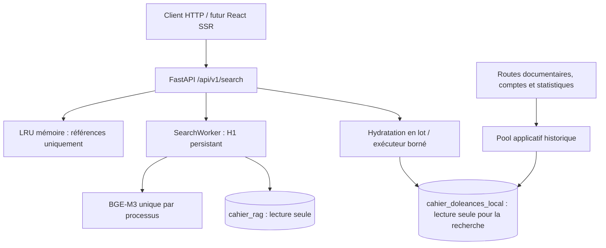

# SEARCH-004 — Intégration FastAPI, provenance et pagination

Rapport du 20 octobre 2026. Périmètre : Hal9000 local uniquement.

## 1. Résultat

**Le véritable service SEARCH-003 est intégré à FastAPI et le nouvel endpoint
`GET /api/v1/search` fonctionne sur les deux bases locales.** Les résultats sont
reliés aux réponses originales, regroupés par réponse et paginés dans un instantané
temporaire. Les pages suivantes et le retour à la première page ne recalculent
ni embeddings de requête, ni lexical, ni ANN, ni RRF.

Le modèle BGE-M3 est chargé une seule fois par processus et réutilisé entre
recherches. Son initialisation se fait en arrière-plan au démarrage : la consultation
documentaire est disponible pendant le chargement ou après un échec de recherche.
Le smoke test réel a vérifié une page Enquêtes accessible pendant le chargement,
avec recherche en 503 jusqu'à disponibilité du modèle.

Profil inchangé : profondeur 50 par branche, sortie top 50 documentaire, lexical
RAG-027 sans préfiltrage, ANN ef1000/400 candidats initiaux, RRF k=60. Ces valeurs
restent une recette configurable et ne définissent pas une limite structurelle
de l'API. Aucun élargissement de profondeur n'a été expérimenté dans SEARCH-004.

Aucun déploiement, accès à Wallace, migration, modification du corpus de travail
ou reconstruction d'embeddings/index n'a eu lieu. Les écritures de fixtures sont
limitées aux bases `_test` et nettoyées. Les seules nouvelles données locales
persistantes de configuration sont une clé HMAC et les paramètres du service,
dans un fichier ignoré par Git et protégé en 0600.

## 2. Modifications effectuées

| Fichiers | Responsabilité |
|---|---|
| [`app/hybrid_runtime.py`](../app/hybrid_runtime.py), [`app/app.py`](../app/app.py) | Lifespan, initialisation indépendante, liaison aux deux bases, arrêt et validation structurée des paramètres |
| [`app/routers/api_hybrid_search.py`](../app/routers/api_hybrid_search.py) | Endpoint cible, budget global, annulation HTTP, calcul initial et navigation dans les instantanés |
| [`app/schemas/hybrid_search.py`](../app/schemas/hybrid_search.py) | Réponse publique et enveloppe d'erreur, BIGINT chaînes, fenêtre explicitement non exhaustive |
| [`app/services/search_hydration.py`](../app/services/search_hydration.py) | Lecture applicative en lot, vérification des unités et relations, construction des cartes publiques |
| [`app/services/search_snapshots.py`](../app/services/search_snapshots.py) | Références compactes, regroupement, LRU/TTL/poids, curseurs HMAC versionnés |
| [`SearchWorker`](../rag/src/cahier_rag/search/service/worker.py) | Accepte un budget externe partagé ; aucun changement de classement H1 |
| [`pyproject.toml`](../pyproject.toml), [`uv.lock`](../uv.lock) | Package RAG local et extra GPU de recherche verrouillés avec le backend |
| [`app/logging_filters.py`](../app/logging_filters.py) | Masquage de q/curseur du nouvel endpoint dans les journaux d'accès |
| [`app/routers/api_search.py`](../app/routers/api_search.py) | Anciennes opérations seulement marquées dépréciées, conservées pour la transition React |
| [`frontend/contracts/openapi.json`](../frontend/contracts/openapi.json), [`api.generated.ts`](../frontend/contracts/api.generated.ts) | Contrat exporté et types générés ; aucune modification d'UX React |
| [`scripts/smoke_hybrid_api.py`](../scripts/smoke_hybrid_api.py) | Vérification HTTP/ASGI locale avec modèle et bases réels, sortie sans texte citoyen |

La documentation comprend le [contrat API](api-search.md), le [guide local](search-local.md)
et une mise à jour du [service SEARCH-003](../rag/service-recherche.md).
Les nouvelles fixtures réutilisent le petit corpus synthétique de SEARCH-003 ;
son encodeur de test est maintenant autonome, sans import d'un module de tests
unitaires lors de l'intégration dans les tests applicatifs.

## 3. Architecture réellement implémentée



### Cycle de vie et indépendance documentaire

Le lifespan construit le backend et lance son initialisation en tâche de fond,
puis laisse FastAPI accepter les requêtes documentaires. La recherche est prête
après vérification des identités, de la source applicative, du corpus, des
statistiques, des index et après chargement/préparation BGE-M3. Une panne de
configuration, PostgreSQL ou modèle n'empêche pas l'application de démarrer.

La validation de source compare les identités physiques complètes de la connexion
source SEARCH-003 et de la connexion d'hydratation applicative, révision comprise.
Une `DATABASE_URL` accidentellement dirigée vers une autre base ne produit donc
pas de résultats mélangés. Les protections READ ONLY et le rôle dédié de SEARCH-003
restent inchangés. Le pool historique conserve les droits nécessaires aux autres
fonctionnalités ; les écritures de comptes ne passent pas par la connexion RAG.

L'arrêt annule une initialisation encore en cours, attend la fin réelle des
travaux synchrones puis libère exécuteurs, modèle et pools. Aucun téléchargement
de modèle par requête, Qwen, générateur, assembleur de contexte ou reranker.

### Concurrence et échéance commune

Le calcul H1 conserve un thread, un calcul actif et deux recherches au plus en
attente. L'hydratation dispose de deux threads, d'un pool de lecture sans overflow
et de quatre travaux admis au plus. Une attente HTTP annulée ne libère pas la
capacité d'un calcul qui utilise encore CPU/GPU ou PostgreSQL.

L'API crée **une seule échéance de 18 secondes**. Le même objet `Budget` traverse
SearchWorker, la lecture applicative et la sérialisation. Les limites internes
restent plafonnées par ce budget résiduel : admission 1 s, encodage 3 s, lexical/ANN
réunis 10 s, hydratation 2 s. Aucun budget supplémentaire n'est accordé après H1.
Le timeout SSR existant de 20 s n'est pas modifié.

Les accès SQL/inférences bloquants s'exécutent hors event loop. La déconnexion ou
l'annulation HTTP signale le budget ; les moniteurs annulent la connexion psycopg2
active et les contextes effectuent rollback/fermeture. Une inférence en thread
n'est pas tuée : son résultat tardif est ignoré et son permis conservé jusqu'à
sa fin. Le cas d'un encodeur durablement bloqué reste une limite de SEARCH-003.

## 4. Provenance et construction des résultats

Après H1, les segments ont déjà été ramenés à un document par SEARCH-003. L'API
regroupe ensuite les documents par `answer_id`, dans l'ordre de leur première
apparition. Elle ne somme aucun score et ne fusionne jamais deux réponses
historiques, même si leurs textes sont identiques.

La première recherche lit toutes les réponses distinctes de sa fenêtre dans
**une requête applicative** : réponses, questions, contributions et formulaires.
Chaque ligne est restaurée en unités via l'adaptateur source déjà utilisé par
le RAG. Les identifiants, les rattachements de formulaire, le document, son indice
d'unité et son empreinte doivent correspondre aux références classées. Les lectures
par PK sont groupées ; aucun appel SQL ou HTTP supplémentaire par résultat.

La base applicative produit les textes publics : les documents RAG ne sont pas
utilisés comme substitut lorsque la source manque. Le texte d'une réponse ouverte
vient de `answers.text` ; les champs « Autre » viennent de `value_json.other_text`,
avec leurs indices et contenus distincts dans l'ordre source. Une carte est
abrégée à 1000 caractères cumulés, avec indicateur explicite.

Les champs publics sont une liste blanche : question, textes, formulaire et
identifiants/liens. Aucun auteur n'est exposé dans ce contrat, ce qui évite toute
projection nouvelle d'identité. Les règles d'anonymat des pages de contribution
restent celles des services existants. Les BIGINT sont des chaînes JSON, et les
liens gardent `/forms/{form_id}/contributions/{contribution_id}#answer-{answer_id}`.
La question est toujours incluse, notamment pour « oui » et « non ».

Une réponse incohérente est écartée avec avertissement. Si au moins cinq cartes
sont contrôlées et au moins la moitié incohérentes, la recherche est bloquée en
503 et le cache invalidé. Ce seuil opérationnel prudent rend explicite la réaction
à une dérive importante ; il ne remplace pas un audit exhaustif. Il s'applique
également à une page revalidée pendant la navigation.

## 5. Contrat HTTP définitif

`GET /api/v1/search?q=…&page_size=20&cursor=…`

| Entrée | Validation |
|---|---|
| `q` | Maximum 512 caractères avant NFC et retrait des espaces extérieurs ; vide sans moteur ; langage naturel |
| `page_size` | 1 à 20, défaut 20, lié à l'instantané |
| `cursor` | Opaque, authentifié/versionné, maximum 1024 caractères |

Les paramètres inconnus/répétés sont refusés. Le futur `question_id` est donc
explicitement rejeté ; aucune recherche filtrée ni filtrage a posteriori du top 50.
La préparation lexicale H1 subsiste, sans promettre sa syntaxe booléenne à la
branche vectorielle. Les entrées invalides sont traduites en 422 structuré.

La réponse `HybridSearchPage` comprend :

- `q`, `state`, `mode="hybrid"`, `recipe_version` ;
- `items` : `answer_id`, `contribution_id`, rang stable, `texts[]`, troncature,
  question, formulaire et URL ancrée ;
- taille de page, `has_next`, curseurs suivant/précédent/première page et expiration ;
- `window.document_limit`, `window.retrieval_depth`, `window.answer_count`,
  `exhaustive=false` ;
- avertissements de sources devenues indisponibles.

Les états sont `idle`, `results`, `empty` et `sources_unavailable`. Le dernier
empêche de confondre des sources retirées avec un classement ne trouvant rien.
Les scores, distances, vecteurs, empreintes et métadonnées privées ne sont pas
envoyés au navigateur. Le [contrat détaillé](api-search.md) et OpenAPI sont les
références pour SEARCH-005.

### Erreurs structurées

```json
{"error":{"code":"search_expired","message":"Cette sélection a expiré. Relancez la recherche.","retryable":false},"request_id":"identifiant-technique"}
```

| HTTP | Cas |
|---|---|
| 422 | Requête/paramètre/curseur invalide ou incompatible |
| 410 | Classement expiré, évincé, perdu après redémarrage ou version invalidée |
| 503 | Recherche/modèle non prêt, base indisponible, hydratation indisponible, saturation ou incohérence importante |
| 504 | Expiration globale, encodage, SQL ou hydratation ; annulation signalée |
| 500 | Erreur interne, sans détails techniques exposés |
| 200 | États fonctionnels, dont un vrai résultat vide |

Les codes différencient les étapes de timeout et l'indisponibilité des métadonnées.
La saturation inclut `Retry-After: 1`. Les erreurs ne réutilisent ni texte RAG de
secours ni ancien moteur. Les réponses sont privées/non cachables par HTTP ; les
paramètres du nouvel endpoint sont masqués dans les journaux d'accès.

## 6. Instantanés et pagination

Le cache mémoire LRU conserve au plus **256 instantanés**, pendant **600 secondes
absolues**, avec **16 Mio de charge utile JSON** au maximum. Ce plafond ne prétend
pas couvrir l'overhead des objets Python. Une entrée contient uniquement les
références document/réponse/question/contribution/formulaire, indices et empreintes,
positions, versions et hash de requête. Ni texte, ni vecteur, ni requête brute.

Le curseur contient une référence aléatoire d'instantané et une position, avec
version et HMAC-SHA256. Il est lié côté cache à la requête normalisée et à la
taille de page. La clé aléatoire dédiée est stockée localement hors Git en 0600.
L'opacité est un contrat client, pas une affirmation de chiffrement du curseur.

Les pages suivantes relisent un seul lot applicatif pour leurs positions. Une
source retirée ne provoque pas un remplissage par la page suivante : les positions
et les rangs restent stables. Le retour à `first_cursor` retrouve le même classement
tant que sources et instantané sont valides. Ni expiration ni erreur de curseur
ne provoque de nouveau calcul silencieux.

La fenêtre initiale garde le profil H1 de référence. Un élargissement futur peut
réutiliser la recette, les références, les curseurs et l'hydratation ; les lecteurs
SEARCH-003 ont encore leur borne technique actuelle de 100 documents par branche,
à adapter et mesurer avant une profondeur de plusieurs centaines ou 1789.
L'API ne publie aucun total exhaustif ou accès arbitraire hors fenêtre.

Un changement de recette/génération détecté invalide la navigation. Un refus de
compatibilité du moteur invalide également les instantanés. Le corpus doit rester
immuable pendant son exploitation : une page de cache n'interroge pas PostgreSQL
RAG pour découvrir une maintenance concurrente. La base publique est revalidée
à chaque page ; il n'existe pas de snapshot transactionnel partagé entre bases.

## 7. Tests et vérifications

Résultats sur l'état final :

| Vérification | Résultat |
|---|---|
| Suite backend `pytest tests -q` avec les deux bases `_test` | **349 réussites**, un test d'import ignoré faute de `GDN_IMPORT_TEST_DATABASE_URL`, sept sous-tests réussis |
| Dont nouveaux tests SEARCH-004 | **29 cas** HTTP/unitaires et intégrations |
| Régression ciblée du service SEARCH-003 et de ses intégrations | **25 réussites** |
| Ruff et contrôle de formatage des fichiers concernés | Conformes |
| Export OpenAPI déterministe hors réseau et vérification du snapshot | Conforme |
| Types OpenAPI générés et `contract:types:check` | Conformes |
| `pnpm --dir frontend typecheck` | Conforme ; aucun changement d'UX |
| Résolution `uv lock --check` et installation verrouillée avec l'extra search | Conformes |

Les nouveaux tests couvrent ordre, BIGINT au-delà de 2^53, segments/documents et
unités « Autre », fidélité des textes, relations invalides, absence de données
privées, états vides, paramètres inconnus, curseurs altérés/incompatibles,
expiration/LRU/poids, retours de pages sans recalcul, source supprimée sans
décalage, refus global des sources incohérentes, erreurs typées et budget partagé.

Les intégrations utilisent les **deux bases isolées**, le vrai lexical/ANN/RRF et
un encodeur déterministe. Le rôle propriétaire de fixture reste sous READ ONLY ;
son seul contrôle de rôle est simulé dans ces tests fonctionnels, comme SEARCH-003.
Le smoke test réel ci-dessous utilise bien le rôle dédié non propriétaire.
Les fixtures d'écriture refusent les noms ne finissant pas par `_test`.

Une instruction SQL d'hydratation volontairement lente sur `_test` est annulée ;
la connexion est ensuite réutilisable. Un test annule une requête HTTP pendant
l'encodage, vérifie que le permis reste occupé jusqu'à la fin réelle et que les
routes documentaires restent réactives. Le démarrage asynchrone bloqué du modèle
ne bloque pas l'ouverture de FastAPI. Les anciennes fonctions documentaires,
statistiques, anonymat, comptes et contrats historiques restent couverts par la
suite backend existante.

Les avertissements observés concernent la dépréciation existante de l'usage httpx
par TestClient et les operation IDs SEO existants ; aucun échec de contrat public.
Le nouveau rendu React SSR et le parcours sans JavaScript sont réservés à SEARCH-005.

## 8. Smoke test réel local et performances

Le script [smoke_hybrid_api.py](../scripts/smoke_hybrid_api.py) a été exécuté avec
l'environnement FastAPI verrouillé, BGE-M3 existant sur RTX 5090, les deux bases
locales et le rôle `cahier_search_reader` déjà provisionné. Deux passages bornés
ont été effectués pendant l'intégration, soit quatre nouveaux classements H1 au
total. Le tableau retient le dernier passage, pas un agrégat de benchmark.

Le test utilise HTTP via TestClient/ASGI, avec véritable lifespan et sérialisation,
sans serveur durable ni mesure réseau intermachines. Les demandes étaient :

1. « Comment améliorer les transports publics ? » ;
2. page suivante du même instantané ;
3. retour à sa première page ;
4. « Comment réduire les dépenses contraintes ? ».

Le modèle a été chargé une seule fois dans ce processus (**4,78 s**, puis une
inférence de préparation). Les requêtes de consultation documentaire répondaient
200 pendant ce chargement et la recherche répondait alors 503. Les deux nouvelles
recherches ont gardé la même instance de modèle. Le compteur d'appels H1 vaut
**deux**, et non quatre : les deux navigations n'ont pas recalculé le classement.

| Étape | Transports | Dépenses | Page suivante | Retour première page |
|---|---:|---:|---:|---:|
| Vérification du corpus | 3,92 ms | 4,48 ms | — | — |
| Encodage chaud | 10,57 ms | 10,74 ms | **aucun** | **aucun** |
| Lexical | 2,585 s | 2,591 s | **aucun** | **aucun** |
| Vectoriel et restauration RAG | 53,47 ms | 62,65 ms | **aucun** | **aucun** |
| Fusion | 0,56 ms | 0,60 ms | **aucune** | **aucune** |
| Hydratation applicative | 22,21 ms | 16,37 ms | 7,67 ms | 7,88 ms |
| Total API jusqu'à sérialisation | **2,686 s** | **2,694 s** | **8,18 ms** | **8,53 ms** |
| Aller-retour HTTP/ASGI local | **2,689 s** | **2,696 s** | **9,86 ms** | **9,97 ms** |

La première page contient 20 cartes, pour une fenêtre de 50 réponses distinctes
sur ce test. La deuxième page ne partage aucun ID de réponse avec la première.
Le retour initial produit une réponse identique. Le lien ancré de la première
carte conduit à une contribution dont l'API contient bien l'ID de réponse retenu.
Aucun texte citoyen, mot de passe ou identifiant de réponse n'est consigné ici.

Comparaison avec SEARCH-003 : les mêmes formulations y avaient donné 2,865 s et
3,052 s hors chargement et sans hydratation/API, avec environ 10 ms d'encodage,
2,59/2,57 s de lexical et 262/462 ms de vectoriel/restauration. Le lexical et
l'encodage sont du même ordre ici ; le vectoriel était plus rapide lors de ces
observations, compatibles avec des effets de cache/charge différents. Aucune
amélioration algorithmique ni garantie de performance ne peut en être déduite.
L'hydratation ajoute ici 16 à 22 ms pour la fenêtre initiale.

Ces observations ne sont ni un P95, ni un SLA public, ni un test de concurrence
représentatif, ni une validation de rappel ANN. Aucun benchmark lourd n'a été lancé.

## 9. Limites et écarts par rapport à SEARCH-002

- **Initialisation en arrière-plan** : précision d'implémentation permettant de
  rendre les pages documentaires disponibles avant la fin du chargement, et pas
  seulement après son échec. La recherche indique explicitement son indisponibilité.
- **Pool d'hydratation séparé** : mêmes données applicatives de référence, avec
  READ ONLY et attentes courtes, pour ne pas monopoliser le pool de navigation.
- **Seuil de divergence explicite** : cinq cartes minimum et moitié incohérentes ;
  règle opérationnelle initiale à suivre, sans qualification statistique du corpus.
- **Identité d'auteur absente** : la carte V1 n'en a pas besoin ; l'absence évite
  d'ajouter une projection d'anonymat alors que question/texte/formulaire/lien suffisent.
- **Anciennes routes transitoires conservées** : autorisé par SEARCH-004 pour
  l'interface actuelle ; marquées dépréciées, sans appel depuis la nouvelle route.
- **Processus unique et cache volatile** : un redémarrage ou une éviction donne
  410 ; plusieurs workers exigeraient un cache partagé et une stratégie de modèle.
- **Annulation coopérative** : elle ne tue pas une inférence ; une supervision
  externe est nécessaire pour une panne durable du thread d'encodage.
- **Fenêtre initiale limitée et ANN approximatif** : réserves de rappel de RAG-027
  maintenues, sans reconstruction ou campagne supplémentaire.
- **CPU/Wallace non qualifié** : interface d'encodage compatible, distribution et
  latences à vérifier plus tard ; aucune intervention distante.

## 10. Points d'attention pour SEARCH-005

1. Brancher le loader SSR sur `/api/v1/search`, avec le signal d'annulation et le
   timeout client existant de 20 s ; adapter les codes d'erreur structurés.
2. Remplacer les onglets par une recherche unique. Toujours afficher la question
   avec la réponse, les textes « Autre » distincts, le formulaire et le lien fourni.
3. Traiter `answer_id` et les autres identifiants comme des chaînes ; rendre les
   textes comme texte, jamais comme HTML injecté.
4. Utiliser les trois curseurs renvoyés. Construire des liens GET complets avec q,
   taille et curseur ; utiliser `first_cursor` pour retrouver l'instantané initial.
5. Différencier 410, 503, 504, vraie absence de résultat et sources retirées. Ne pas
   relancer silencieusement H1 sur un curseur perdu ou afficher un ancien lot sans l'indiquer.
6. Afficher que la fenêtre est bornée/non exhaustive, sans présenter son compteur
   comme un nombre global de correspondances. Ne pas figer 50 dans l'architecture frontend.
7. Garder la navigation Enquêtes et les pages documentaires. Le filtre question
   et l'action d'exploration restent des chantiers ultérieurs.
8. Retirer les anciennes routes et les appels/types/tests React historiques lors
   de la bascule coordonnée, puis poursuivre le nettoyage de dépendances dans SEARCH-006.

**SEARCH-004 s'arrête à cette intégration backend, ses validations et ce rapport.
SEARCH-005 n'est pas commencé.**
